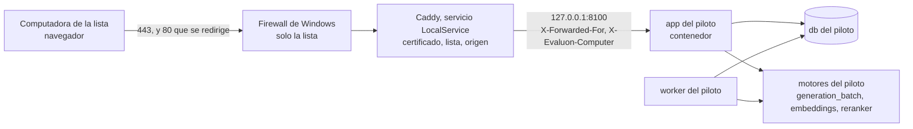

# Plan 007 · Acceso por red

Estado: propuesto (versión 2, con la revisión del Coordinador del 2026-10-14) · Fecha: 2026-10-14 · Aprobó: —

Spec: `specs/007-acceso-por-red/spec.md` (aprobada el 2026-10-14)

ADR de este plan, **propuestos**:

- `docs/adr/0061-intermediario-cifrado-en-windows-y-lista-por-direccion.md`
- `docs/adr/0062-certificado-en-dos-variantes-con-los-mismos-archivos.md`
- `docs/adr/0063-bloqueo-sesion-y-cambio-de-clave-con-django.md`, que enmienda el ADR-0005 en la clave olvidada y en los comandos de administración de usuarios
- `docs/adr/0064-instancia-del-piloto-y-gpu-para-una-instancia-a-la-vez.md`

Se apoya en:

- el ADR-0005 (Django 6.1, sesiones en la base, Argon2id, comandos);
- el ADR-0057 (configuración de uso con el 27B);
- el ADR-0060 (excepción de P4 durante la estabilización);
- T-049 de la 001, integrada en `main` (b6dec485): instalación desde cero y «Datos para el runbook».

Lo que este plan propone y necesita una decisión del responsable está al final, en «Puntos para el responsable», numerado para aprobarlo fila por fila. Donde una tarea depende de una de esas filas, lo dice.

## Resumen del enfoque

1. **Red (REQ-109, REQ-110, REQ-116).**
   - **Por qué en Windows.** Docker Desktop no les pasa a los contenedores la dirección de la computadora que se conecta (ADR-0061). Si el cifrado y la lista se resolvieran dentro de Docker, la aplicación no sabría desde qué computadora entró cada uno (REQ-113). Por eso el cifrado lo hace un **intermediario que corre en Windows**: Caddy 2.11, como servicio con la cuenta sin privilegios `LocalService`.
   - **Qué hace el intermediario:**
     - atiende 80 y 443 hacia la red;
     - cifra con el certificado de una carpeta protegida;
     - redirige lo que llega sin cifrar;
     - corta la conexión de toda computadora que no está en la lista;
     - agrega la dirección y el nombre de la computadora al pedido;
     - lo pasa a la aplicación por `127.0.0.1`.
   - **Qué no hace:** no tiene API de administración, no usa HTTP/3 y no se conecta a internet.
   - **Docker sigue sin publicar nada hacia la red.**
   - **Firewall:** el de Windows deja entrar a 80 y 443 solo desde la lista, en cualquier perfil de red.
   - **La lista:** vive en el `.env` del piloto. El responsable la aplica con un script de administrador que corre desde una carpeta donde solo escriben los administradores.
   - **Certificado:** son dos archivos. Los produce una autoridad propia limitada a EVALUON, o el área de sistemas firmando un pedido hecho en el equipo; pasar de una variante a la otra es reemplazarlos (ADR-0062).
2. **Acceso (REQ-111 a REQ-115).** Con lo que trae Django, sin bibliotecas nuevas (ADR-0063):
   - un backend que bloquea 15 minutos tras 5 fallidos seguidos, para la pantalla y los comandos;
   - el cambio de clave de Django, que respeta el bloqueo y rechaza claves cortas, comunes o iguales a la actual;
   - una marca de clave inicial;
   - un middleware que cierra la sesión a los 30 minutos sin uso y a las 8 horas, sin contar como uso ni el sondeo ni las tres pantallas que se recargan solas;
   - el registro de accesos con la computadora de origen;
   - comandos de administración que reemplazan a `changepassword` y `createsuperuser`;
   - si el responsable aprueba el punto 1, una pantalla chica del registro de accesos con el botón de desbloquear.
3. **Instancia del piloto (REQ-117).**
   - **Separada:** un segundo proyecto de Docker Compose (`evaluon-piloto`) en `C:\EVALUON-piloto\`, con permisos propios, y base, volúmenes, imagen, puerto, respaldos, secretos y motores propios (ADR-0064).
   - **La GPU:** entra un solo 27B, así que una sola instancia tiene el motor de generación a la vez. Lo mueve un script que se niega si hay trabajos en curso.
   - **El nombre del proyecto:** toda orden de Docker sobre el piloto pasa por un script que lo fija y que rechaza las órdenes peligrosas.
   - **Despliegue (P11):** la instancia del piloto es el destino del despliegue de esta feature.

Orden:

1. **Corte vertical** (T-269 a T-271): el ingreso servido cifrado a una computadora de la lista, con un usuario de prueba, y el pliego del caso chico subido desde esa computadora. Si no llega, una corrección única (T-281).
2. Recién después, **el resto**, en dos líneas: el acceso (T-272 a T-275 y T-282) y la instancia del piloto (T-276, T-283 y T-284), más la herramienta de carga (T-277).
3. **La aceptación en la red** (T-278), con su ronda de corrección (T-279 y T-280).
4. **La verificación del cierre de la estabilización** (T-285), cuando el responsable lo indique.

## Despliegue y carga del proceso reservado (P11)

- **La instancia del piloto es el destino del despliegue de la 007.** Hasta que el responsable apruebe ese despliegue, solo tiene material público: el caso chico y usuarios de prueba.
- **El proceso en curso, reservado, se carga solo después de cuatro cosas, en este orden:**
  1. la aceptación (T-278, o T-280 si hubo corrección);
  2. el dictamen de la auditoría de la feature sin hallazgos bloqueantes (etapa 6, ADR-0036 y ADR-0052);
  3. lo que el responsable apruebe de los puntos 4 y 8;
  4. la aprobación del despliegue por el responsable (etapa 7; línea `Despliegue: aprobado` de `tasks.md`).
- **Toda actualización posterior del piloto es un despliegue** que aprueba el responsable. Se hace con `scripts/piloto/actualizar.ps1` (T-276).

## Criterio de aceptación numérico y umbrales (escritos antes de medir)

Criterio de la feature (spec, literal): «desde una computadora de la lista, el recorrido del caso chico (procedimiento, pliego y matriz, ofertas, evaluación y dictamen, normativas) se completa en 5 de 5 secciones, con 0 páginas servidas sin cifrar y 0 advertencias del navegador; desde una computadora fuera de la lista, 0 páginas; y desde cualquier computadora de la red, 0 conexiones aceptadas por los servicios internos».

Corte vertical (spec, literal): «primero una sola pantalla (el ingreso) servida cifrada a una computadora de la lista, con un usuario de prueba y el caso chico público; después el resto».

En T-271 el usuario de prueba ingresa y sube desde la computadora de la lista el pliego del caso chico. La lectura y el resto del recorrido necesitan el motor y se completan en T-278 (punto 21).

| Qué | Umbral | Con qué se mide | Tarea |
|---|---|---|---|
| Recorrido del caso chico desde una computadora de la lista (REQ-109) | 5 de 5 secciones completas con un usuario evaluador | El responsable recorre en el navegador con la lista del testeador | T-278 |
| Páginas sin cifrar (REQ-110) | 0: toda dirección `http://` termina en `https://` con una redirección del intermediario, sin cuerpo de la aplicación | `curl.exe -sI` por `http://` al ingreso, a una página de cada sección y a un estático | T-271 (ingreso), T-278 (todas) |
| Advertencias del navegador (REQ-110) | 0 en cada computadora de la lista que se prueba, con el navegador de la Comisión | Abrir la dirección; captura de la barra | T-271, T-278 |
| Clave legible en el tráfico de un ingreso (REQ-110) | 0 apariciones | Captura con `pktmon` en el equipo (PowerShell de administrador), convertida con `pktmon etl2pcap`, y búsqueda del texto de la clave | T-271 |
| Computadora fuera de la lista (REQ-109) | 0 páginas por `http` y por `https`. Una computadora que se saca y se vuelve a poner llega sin tocar el código | Navegador y `Test-NetConnection` desde una computadora fuera de la lista | T-271, T-278 |
| Servicios internos (REQ-116) | 0 conexiones aceptadas desde la red. En el equipo, ningún proceso escucha fuera del propio equipo salvo `caddy.exe` en TCP 80 y 443 y los servicios de Windows anotados | `Test-NetConnection` a 80, 443, 5432, 8000, 8080, 8100, 2019 y 2375 desde una computadora de la lista y desde una de fuera; inventario con `Get-NetTCPConnection -State Listen` y `Get-NetUDPEndpoint`, con su proceso | T-271, T-278 |
| Bloqueo (REQ-111) | Tras 5 fallidos seguidos, la clave correcta se rechaza con el mismo mensaje durante 15 minutos y después ingresa; con 4 fallidos y uno correcto ingresa y la cuenta vuelve a 0; 3 de 3 mensajes idénticos; lo mismo por comando | Tests con el reloj controlado y con pedidos simultáneos; una vez desde otra computadora | T-272, T-278 |
| Tiempo de respuesta del ingreso (REQ-111, que el bloqueo no se delate) | Diferencia de medianas menor que 25 ms entre usuario inexistente, clave equivocada y usuario bloqueado, con 20 intentos de cada uno | `medir_carga.py --tiempos-ingreso` | T-278 |
| Desbloqueo y registro (REQ-112, REQ-113) | Tras el desbloqueo, ingresa enseguida. El registro muestra 4 de 4 hechos (ingreso, intento fallido, bloqueo, desbloqueo) hechos desde otra computadora, con usuario o nombre escrito, computadora de origen, fecha y hora, y el desbloqueo con quién | Tests; la pantalla del registro desde otra computadora (punto 1) y `ver_accesos` en el equipo | T-273, T-282, T-278 |
| Cambio de clave (REQ-114) | Con clave inicial, 0 secciones usables hasta cambiarla. Se rechaza, con el motivo, una clave nueva corta, común o igual a la actual, y un cambio sin la clave actual correcta | Tests; una vez desde otra computadora | T-275, T-278 |
| Inactividad y tope (REQ-115) | A los 30 minutos sin uso, el siguiente pedido lleva al ingreso; a las 8 horas también; lo guardado sigue. El sondeo y las tres recargas automáticas no cuentan como uso | Tests con el reloj controlado, uno por pantalla; una vez real desde otra computadora (31 minutos) | T-274, T-278 |
| Cierre del navegador (REQ-115) | Cerrar todas las ventanas del navegador y volver a abrirlo lleva al ingreso | En la computadora de la lista, con el navegador real; se anotan el navegador y su configuración de restauración y de arranque rápido | T-278 |
| Carga (no funcional) | Según la decisión del punto 5, que se copia literal a la spec antes de medir. En todo caso, p95 menor que 2 s por página con 10 sesiones | `scripts/red/medir_carga.py` por el intermediario, con la línea de base de una sesión desde el equipo medida dos veces; más una carga por sección desde la computadora de la lista | T-278 |
| Instancia separada durante la estabilización (REQ-117) | 0 tareas de construcción que usen el proyecto, la base, los volúmenes, los respaldos o la carpeta del piloto. 0 archivos del proceso en el repositorio. La IA del piloto solo local. Salida a internet: solo `portal_worker` (y `app`, si el punto 4 no se aprueba, anotada como riesgo aceptado) | `docker compose config` de las dos instancias; búsqueda de los nombres del piloto en scripts y comandos de construcción; clon del piloto sin remoto de escritura; motores con `--offline`; redes de cada servicio | T-276, T-278 |
| Instancia separada al terminar la estabilización (REQ-117) | Un agente no puede leer `C:\EVALUON-piloto\`, ni correr Docker sobre `evaluon-piloto`, ni pedir páginas al piloto. Las claves de la base y de Django del piloto cambiaron. Los usuarios cuya clave conocían los agentes tienen una clave nueva | Lista de cierre de `instancia-piloto.md`, aplicada por el responsable y probada por un agente que intenta y es rechazado | T-285 |

**Rondas (ADR-0024 y ADR-0025).**

- **El corte vertical:** T-271 es la ronda 1. Si no llega, T-281 corrige todo en una sola tarea y su verificación repite T-271 completa una vez (ronda 2).
- **La aceptación:** T-278 es la ronda 1. T-279 corrige todo en una sola tarea y T-280 repite T-278 completa sobre el commit corregido (ronda 2).
- **Si después de la ronda 2 se sigue perdiendo un requisito o se viola un principio:** el responsable decide si se abre una ronda más.
- **Lo que no llega sin eso:** pasa con su impacto a «Revisión con el primer producto», en `tasks.md`.

## Definiciones compartidas

Fijas antes de paralelizar. Una tarea que necesite cambiar una la deja como hallazgo y decide el Coordinador.

**Carpetas y permisos en el equipo del sistema** (las crea `instalar-red.ps1`, como administrador, con la herencia de permisos cortada):

| Carpeta | Qué guarda | Quién escribe | Quién lee |
|---|---|---|---|
| `C:\Program Files\EVALUON-Red\` | `caddy.exe`, `aplicar-red.ps1` y `desinstalar-red.ps1`, copiados de un clon limpio en el commit aprobado | Administradores y SYSTEM | Todos (lectura y ejecución) |
| `C:\ProgramData\EVALUON-Red\` | `Caddyfile`, `certificados\` (`evaluon.crt` y `evaluon.key`), `datos\` (almacenamiento de Caddy) y `registros\` (registro de Caddy, con rotación) | Administradores y SYSTEM; `LocalService` solo en `datos\` y `registros\` | `LocalService`: el `Caddyfile` y `certificados\`. El usuario del responsable no lee `certificados\` |
| `C:\EVALUON-piloto\` | `evaluon\` (clon), `respaldos\`, `entrada\` (lo que generan los scripts sin administrador, antes de aplicarlo) y `motor-gpu.txt` (qué instancia tiene el motor) | Administradores, SYSTEM y el usuario del responsable | Los mismos |
| Unidad extraíble del responsable | La autoridad propia: su clave, cifrada con una frase de paso | El responsable | El responsable |

Nunca se corre como administrador código que un usuario común pueda modificar. Los scripts de administrador se ejecutan desde `C:\Program Files\EVALUON-Red\` y solo leen datos de `entrada\`: el `Caddyfile`, la lista y el certificado generados. Python no corre como administrador.

**Variables del `.env` de la instancia del piloto** (bloque comentado en `.env.example`; los nombres son identificadores y van en inglés):

| Variable | Valor | La lee |
|---|---|---|
| `COMPOSE_PROJECT_NAME` | `evaluon-piloto` | Docker Compose, `compose.ps1`, `caddy.py` y `aplicar-red.ps1`, que se niegan si falta |
| `COMPOSE_FILE` | la de uso de `.env.example` más `:docker-compose.piloto.yml`, y `:docker-compose.sin-gpu.yml` mientras el piloto no tenga el motor (lo maneja `gpu.ps1`) | Docker Compose |
| `APP_PORT` | `8100`; los scripts se niegan con `8000` | compose (`127.0.0.1:${APP_PORT}:8000`) y `caddy.py` |
| `EVALUON_HTTPS` | `true` (en construcción falta y vale `false`) | `settings.py` |
| `DJANGO_ALLOWED_HOSTS` | la dirección fija, `localhost,127.0.0.1` | `settings.py` |
| `EVALUON_ADDRESS` | la dirección fija con que se entra: un nombre del DNS interno o la IPv4 del equipo | `caddy.py`, `crear-certificados.sh` |
| `EVALUON_SERVER_IP` | IPv4 fija del equipo del sistema | `caddy.py`, `crear-certificados.sh` |
| `EVALUON_COMPUTERS` | `nombre=dirección` separados por comas; nombres en minúsculas, con números y guiones; IPv4; sin repetidos; **10 como máximo** | `caddy.py` |
| `EVALUON_APP_DB_PASSWORD` | clave del usuario de la base de la aplicación (solo si se aprueba el punto 4) | compose del piloto (T-283) |

**Encabezados que el intermediario pone en cada pedido.** Pisan lo que mande el navegador.

- `X-Forwarded-For`: la dirección de la computadora. Caddy ignora el valor que traiga el cliente.
- `X-Forwarded-Proto: https`.
- `X-Evaluon-Computer`: el nombre de la computadora en la lista, o `equipo-del-sistema`.

La aplicación solo es alcanzable desde el propio equipo, así que los toma. Un pedido sin ellos vino directo al puerto local y se registra como `acceso-directo-local`. Un proceso del propio equipo podría falsearlos (ver «Riesgos»).

**Marcas de pedidos que no cuentan como uso:**

- el encabezado `X-Evaluon-Poll: 1`, que manda el sondeo (`recorrido.js`);
- el parámetro `auto=1` en la dirección, que llevan las tres recargas automáticas:
  - `journey/nuevo.html` y `journey/s1_pliego_borrador.html`, por `meta refresh`;
  - `journey/s3_ofertas.js`, por script.

**Esquema (solo T-272):**

- campos de `accounts_user`: `failed_logins`, `locked_until`, `must_change_password` y, con el punto 2, `is_system_manager`;
- tipos de hecho nuevos: `logout` («Salida»), `lockout` («Bloqueo por intentos fallidos»), `unlock` («Desbloqueo»), `password_change` («Cambio de clave») e `initial_password` («Clave inicial asignada»). Poner o quitar la marca de responsable usa el tipo existente `user_role_changed`.

**Origen en el registro:** `audit_event.detail["origin"] = {"computer": <nombre>, "ip": <dirección o null>}`. `computer` vale:

- el nombre de la lista;
- `equipo-del-sistema`, si es el equipo por el intermediario o un comando;
- `acceso-directo-local`, si es un pedido directo al puerto local;
- `desconocida`, si es un pedido del intermediario sin nombre, que no debería ocurrir.

El origen del ingreso se guarda también en la sesión, para registrar la salida.

**Constantes de `settings.py`:** `LOGIN_FAILURE_LIMIT = 5` y `LOGIN_LOCKOUT_MINUTES = 15` (T-272); `SESSION_IDLE_MINUTES = 30` y `SESSION_MAX_HOURS = 8` (T-274). Son literales de la spec. `SESSION_COOKIE_AGE` sigue en 8 horas y `SESSION_EXPIRE_AT_BROWSER_CLOSE` en verdadero.

**Funciones compartidas:**

- `evaluon.accounts.backends.register_failed_attempt(user, origin)` (T-272): dentro de una transacción con `select_for_update`, suma un fallido y bloquea al quinto, con su hecho `lockout`. Devuelve si quedó bloqueado. No hace nada si el usuario ya está bloqueado.
- `evaluon.accounts.backends.is_locked(user)` (T-272).
- `evaluon.accounts.origin.request_origin(request)` y `COMMAND_ORIGIN` (T-273).
- El motivo de una salida, en `request.evaluon_logout_reason`: `user`, `idle`, `max_age` o `locked_in_form`. Lo pone quien llama a `logout`; lo lee el receptor de la señal (T-273).

**Comandos** (nombres en español, como los demás). Con el punto 2 aprobado, los de administración los corre quien administra el equipo, sin usuario de EVALUON, como hoy `crear_usuario`, y cada uno deja su hecho:

- `desbloquear_usuario <usuario>`;
- `ver_accesos [--desde AAAA-MM-DD] [--hasta AAAA-MM-DD] [--de <usuario>]`;
- `clave_inicial <usuario>`;
- `responsable_sistema <usuario> {si,no}`;
- `changepassword` y `createsuperuser` se reemplazan por comandos propios con el mismo nombre, que no hacen nada y remiten a `clave_inicial` o `crear_usuario`.

**Instancia del piloto:**

- proyecto `evaluon-piloto`; imagen `evaluon-app:piloto`; puerto `127.0.0.1:8100`;
- `docker-compose.piloto.yml`: nombre del proyecto e imagen; con el punto 4, también el usuario de la base y la red sin salida;
- `docker-compose.sin-gpu.yml`: `generation_batch` y `worker` en el perfil `gpu`. Va en el `COMPOSE_FILE` de la instancia que no tiene el motor, cualquiera de las dos.

**Scripts del piloto:**

- `scripts/piloto/compose.ps1`: toda orden de Compose del piloto. Siempre llama a `docker compose --project-directory C:\EVALUON-piloto\evaluon --env-file C:\EVALUON-piloto\evaluon\.env -p evaluon-piloto`. Se niega si el `.env` no tiene `COMPOSE_PROJECT_NAME=evaluon-piloto` y `docker-compose.piloto.yml` en `COMPOSE_FILE`, o si `APP_PORT` es 8000. Rechaza:
  - `-p` y `--project-name`;
  - `-f` y `--file`;
  - `--env-file` y `--project-directory`;
  - `down -v` y `down --volumes`;
  - `rm -v` y `volume rm`.
- `gpu.ps1`, `respaldar.ps1`, `vaciar-base.ps1` y `actualizar.ps1` pasan por `compose.ps1`.

## Componentes

Con el punto 4 aprobado, entre `127.0.0.1:8100` y `app` hay una «puerta» (T-284). Es un contenedor que reenvía la conexión sin tocarla y es el único con el puerto publicado. Así `app` queda solo en la red interna, sin salida a internet.

| Parte | Cambia | Qué cambia | Tarea |
|---|---|---|---|
| Intermediario: Caddy 2.11 en Windows, servicio `EVALUON-Caddy` con `LocalService` | Nuevo, fuera de Docker | Termina el cifrado con los archivos de `C:\ProgramData\EVALUON-Red\certificados\`, redirige `http`, corta lo que no está en la lista, pone los encabezados de origen y reenvía a `127.0.0.1:8100`. En las opciones globales: `admin off`, `auto_https off`, `ocsp_stapling off`, solo HTTP/1.1 y HTTP/2, sin instalar raíces, almacenamiento y registro en `C:\ProgramData\EVALUON-Red\`, y `default_sni` si se entra por IP. Con nombre, encabezado HSTS (punto 18). Se recarga reiniciando el servicio | T-270 |
| Firewall de Windows | Regla nueva | Entrada TCP 80 y 443 para `caddy.exe`, solo desde la lista y el equipo, en todos los perfiles (`-Profile Any`). Desactiva otras reglas de entrada de `caddy.exe` y se niega si el firewall está apagado en el perfil de la red actual | T-270 (script); lo aplica el responsable |
| `scripts/red/` | Nuevo | `caddy.py` (genera `Caddyfile` y lista en `entrada\`), `Caddyfile.plantilla`, `instalar-red.ps1`, `aplicar-red.ps1`, `desinstalar-red.ps1`, `caddy.sha512` y `crear-certificados.sh` (T-270); `medir_carga.py` (T-277) | T-270, T-277 |
| `evaluon/settings.py` | Sí | Modo HTTPS detrás del intermediario, que no arranca con `DJANGO_DEBUG` verdadero; backend único de ingreso y constantes; middleware de sesión y de cambio obligatorio; validadores de clave; `accounts` antes de `django.contrib.auth` para reemplazar sus comandos | T-269, T-272, T-274, T-275 |
| `evaluon/accounts/` | Sí | `backends.py`, `origin.py`, `session_policy.py`, `password_policy.py`, cambio de clave, comandos de administración, `crear_usuario` con clave inicial, receptor de salida y origen; con el punto 1, la pantalla del registro de accesos | T-272 a T-275, T-282 |
| `evaluon/audit/` | Sí | Cinco tipos de hecho; `FORBIDDEN_DETAIL_KEYS` suma `old_password`, `new_password1` y `new_password2` | T-272, T-273 |
| Pantallas | Mínimo | Enlace «Cambiar clave» en el encabezado y su pantalla; con el punto 1, «Registro de accesos» solo para el responsable. Las tres recargas automáticas suman `auto=1` sin cambiar nada visible; el sondeo manda su encabezado | T-274, T-275, T-282 |
| `docker-compose.piloto.yml` | Nuevo | Nombre del proyecto e imagen propia; con el punto 4, usuario de la base y puerta | T-269, T-283, T-284 |
| `docker-compose.sin-gpu.yml` | Nuevo | `generation_batch` y `worker` en el perfil `gpu`, para la instancia que no tiene el motor | T-276 |
| `docker-compose.yml` | Entorno y montajes | `EVALUON_HTTPS` en el entorno de la imagen; monta los archivos nuevos para los tests (regla de T-264) | T-269, T-276 |
| `.env.example`, `.gitattributes` | Sí | Bloque comentado del piloto; `scripts/models.sha256` con fin de línea LF | T-269, T-276 |
| `scripts/piloto/` | Nuevo | `compose.ps1` (T-269); `gpu.ps1`, `respaldar.ps1`, `vaciar-base.ps1` y `actualizar.ps1` (T-276); con el punto 4, `permisos-base.sql` (T-283) | T-269, T-276, T-283 |
| Base, motores, `worker`, `portal_worker`, secciones | No | — | — |

El camino de pliegos y ofertas no depende de ningún servicio externo (P4). El intermediario es local, no pide certificados ni consulta OCSP, y reenvía a `127.0.0.1`. La IA es la de los motores locales con `--offline`. Con internet, solo bajar Caddy (una vez, con la suma SHA-512 publicada) y los modelos.

## Modelo de datos

**Una sola tarea toca el esquema: T-272**, con dos migraciones que corren juntas.

- `accounts_user`:
  - `failed_logins`: entero chico, 0 por omisión;
  - `locked_until`: fecha y hora, vacía por omisión;
  - `must_change_password`: falso por omisión, lo ponen `crear_usuario` y `clave_inicial`;
  - `is_system_manager`: falso por omisión, solo con el punto 2; lo pone `responsable_sistema`.

  Los usuarios existentes quedan con 0, vacío, falso y falso.
- `audit_event.event_type`: los cinco tipos nuevos, con la restricción reemplazada como en la migración `audit 0008`. Sin columnas nuevas: el origen va en `detail`. La tabla sigue siendo de solo inserción.
- Sesión: sin tablas nuevas. El middleware guarda en la sesión el momento del ingreso, el del último uso y el origen.

Con el punto 4, T-283 agrega en la base del piloto un usuario para la aplicación, sin propiedad de las tablas, que en `audit_event` solo puede leer y agregar. No es una migración de Django: es un script del piloto que corre el dueño del esquema después de cada `migrate`.

## Flujo de IA

No aplica. La feature no cambia la recuperación, las instrucciones ni el modelo (P7 no se dispara). El piloto usa la configuración de uso del ADR-0057 con motores propios. Un cambio de modelo o de instrucciones llega al piloto solo con un despliegue aprobado.

## Registro de auditoría

Todo va en `audit_event` (P6), nunca con claves ni identificadores de sesión.

| Hecho | Cuándo | Usuario y nombre | Detalle |
|---|---|---|---|
| `login` | Ingreso correcto, por pantalla o comando | El usuario | `origin`; por comando, `command` |
| `login_failed` | Usuario inexistente, clave equivocada, usuario bloqueado o dado de baja. También la clave actual equivocada en el cambio de clave | En el ingreso, sin usuario y con el nombre escrito (punto 20). En el cambio de clave, el usuario de la sesión | `origin`; en el cambio de clave, `form: password_change`. No dice el motivo |
| `lockout` | Al quinto fallido seguido | El usuario bloqueado | `origin` del quinto intento, `locked_until` |
| `unlock` | Por la pantalla del registro (punto 1), por `desbloquear_usuario`, o por `clave_inicial` sobre un usuario bloqueado | Por pantalla, el responsable. Por comando, sin usuario: «administración del equipo» | `unlocked_user`, `unlocked_user_id`, el `locked_until` que tenía, `origin`, `command` si va por comando |
| `logout` | «Salir»; el cierre por inactividad o por las 8 horas cuando el usuario vuelve; con el punto 6, también la sesión vencida que nadie retomó | El usuario | `origin` (el del ingreso, si la sesión venció sola); `reason`: `user`, `idle`, `max_age` o `locked_in_form`; `expired_at` si venció sola |
| `password_change` | Cambio de clave correcto | El usuario | `origin`; `initial: true` si era la inicial |
| `initial_password` | `clave_inicial` | «Administración del equipo» | `target_user`, `target_user_id`, `command` |
| `user_role_changed` (existe) | `responsable_sistema` | «Administración del equipo» | `changed_user`, `system_manager_before`, `system_manager_after`, `command` |

`ver_accesos` y la pantalla del punto 1 muestran estos hechos con fecha y hora, hecho, usuario o nombre escrito, «computadora (según su dirección)» y canal.

## Instancia del piloto (REQ-117)

| | Construcción (8000) | Piloto |
|---|---|---|
| Carpeta | `C:\Users\snave\Documents\dev\EVALUON` y sus copias | `C:\EVALUON-piloto\evaluon\`, un clon en el commit desplegado, con permisos propios y fuera de carpetas sincronizadas |
| Proyecto | `evaluon` | `evaluon-piloto`, por `COMPOSE_PROJECT_NAME`, `name:` en `docker-compose.piloto.yml` y `compose.ps1` |
| Imagen | `evaluon-app:local` | `evaluon-app:piloto`. Los estáticos (CSS y JS) salen de la imagen, no del código montado: cada actualización la reconstruye |
| Base y volúmenes | `evaluon_*` | `evaluon-piloto_*` |
| Puerto | `127.0.0.1:8000` | `127.0.0.1:8100`, solo para el intermediario |
| Secretos | propios | otros `POSTGRES_PASSWORD` y `DJANGO_SECRET_KEY`; con el punto 4, `EVALUON_APP_DB_PASSWORD` |
| Respaldos | `backups/` | `C:\EVALUON-piloto\respaldos\`, programados cada día, con retención y una copia periódica a un medio que custodia el responsable |
| Modelos | `models/` | enlaces duros a los de construcción, o una copia, verificados con `tr -d '\r' < ../scripts/models.sha256 \| sha256sum -c --ignore-missing -` (orden de T-049) |
| Repositorio | publica por pull request | el clon no tiene dirección de envío |

**El motor de generación, para una instancia a la vez (ADR-0064, punto 3).** No entran dos 27B. Con el 27B de una instancia y embeddings y reranker de las dos, T-049 midió 20.940 MiB de 24.463 (con `nvidia-smi`, que T-049 vio marcar 0 MiB con el 27B cargado: T-278 lo confirma por otra vía).

- **La protección es simétrica:** la instancia que no tiene el motor lleva `docker-compose.sin-gpu.yml` en su `COMPOSE_FILE`, así ningún `up` ni `run` le enciende el 27B.
- **`scripts/piloto/gpu.ps1 -Para piloto|construccion`:**
  - se niega si en la instancia que cede el motor hay pedidos en curso (`tenders_job` en `running`);
  - detiene su `generation_batch` y su `worker`, tolera el error de `docker stop` y espera a que `docker inspect` diga `exited` (T-049: unos 40 s desde la orden, código 137);
  - cambia la línea `COMPOSE_FILE` de los dos `.env`, sin marca BOM y conservando los fines de línea, comprueba con `docker compose config -q` y, si falla, restaura la copia;
  - enciende el destino con `up -d`, espera `/health` y el alias en `/props` (hasta 15 minutos);
  - escribe `C:\EVALUON-piloto\motor-gpu.txt` con quién tiene el motor, desde cuándo y quién lo movió.
- **Órdenes que no leen `COMPOSE_FILE`:** las órdenes de medición con `-f` o con otro `--env-file` (por ejemplo, el `coord.env` del Coordinador) no lo leen. Por eso `gpu.ps1` acepta `-OtrosEnv` para actualizar esos archivos, y todo encargo que use el motor dice quién lo tiene y empieza leyendo `motor-gpu.txt`.
- **Quién mueve el motor** lo fija el punto 3.

**Después de un reinicio de Windows.** Docker Desktop corre en la sesión del usuario y en este equipo no arranca solo. Hay que:

- activar «Start Docker Desktop when you sign in»;
- bloquear la sesión, nunca cerrarla;
- que el equipo no se suspenda ni haga nada al cerrar la tapa;
- fijar el horario de reinicio de Windows Update fuera del uso;
- si el equipo se conecta por Wi-Fi, desactivar las direcciones de hardware aleatorias para esa red, para que la reserva de DHCP no se pierda.

Después de un reinicio, `instancia-piloto.md` indica comprobar con `compose.ps1 ps` y repetir `compose.ps1 up -d` si algo no arrancó (falla 2 de T-049: varios servicios con GPU a la vez). Un motor detenido a mano no vuelve a arrancar solo.

**Actualizar el piloto (despliegue, P11).** `scripts/piloto/actualizar.ps1`, con el commit aprobado:

1. se niega con pedidos en curso;
2. respalda;
3. lleva el clon a ese commit;
4. reconstruye `evaluon-app:piloto`;
5. muestra las migraciones pendientes y, si hay, sigue el procedimiento de migración con respaldo de T-049;
6. con el punto 4, reaplica los permisos de la base;
7. levanta con `up -d --no-deps` los servicios de la imagen propia;
8. comprueba el ingreso.

Antes de cargar el proceso reservado y durante la estabilización, lo corre un agente. Después, el responsable.

**Clave olvidada.** Con `clave_inicial`, que obliga a cambiarla y deja registro. Reemplaza el `changepassword` del runbook de T-049 (ADR-0063 enmienda el ADR-0005). Las órdenes de la sección T-043 que traen `-p evaluon` (O-049-8) no se copian al piloto: van por `compose.ps1`.

**Mediciones.** Corren en la instancia de construcción, con el motor prestado, nunca sobre la base del piloto. Del piloto, la construcción recibe solo lo que el responsable decida compartir: cifras agregadas, sin textos.

**El repositorio, que es público.** Al repositorio van solo cifras, identificadores (REQ, T, ADR) y estados. Nunca contraseñas, direcciones de la red del organismo ni textos del proceso. El clon del piloto no puede publicar; sus respaldos van fuera del clon.

**Agentes.** Durante la estabilización pueden leer la instancia del piloto (ADR-0060). Al terminarla, el responsable aplica la lista de cierre de `instancia-piloto.md`, que verifica T-285:

- reglas de denegación en la configuración de permisos de Claude Code: leer `C:\EVALUON-piloto\`, órdenes de Docker sobre `evaluon-piloto` y pedidos a la dirección del piloto y a `127.0.0.1:8100`;
- clave nueva del usuario de la base con `ALTER ROLE` (cambiar el `.env` solo no alcanza) y de `DJANGO_SECRET_KEY`;
- `clave_inicial` para todo usuario cuya clave haya pasado por un agente.

La separación es de procedimiento: con el mismo usuario de Windows y Docker Desktop, un proceso de ese usuario puede entrar a los contenedores (ADR-0064, punto 6).

**Relación con T-049.** El piloto se instala con su procedimiento más lo de esta feature. Se incorporan sus hallazgos:

- el nombre del proyecto y su salvaguarda;
- la imagen propia;
- el motor que se turna, con sus tiempos y sin `nvidia-smi` como prueba;
- la verificación de los modelos con `tr -d '\r'` (`fetch_models.sh` baja el 12B si falta);
- el fin de línea de `scripts/models.sha256`, que rompe `sha256sum -c` y el `awk` de WSL, aunque no el `fetch_models.sh` de Git Bash;
- O-049-8;
- `changepassword` sin registro;
- los dos pendientes del despliegue (punto 4).

Norton ya no está en el equipo: el responsable lo desinstaló el 2026-10-14 y `docker build --no-cache` pasa en 42 s. Sigue siendo posible un antivirus o un proxy que inspeccione conexiones cifradas en las computadoras de la Comisión (pedido 7).

## Quién hace qué

**El responsable hace solo lo que exige ser administrador de Windows, tocar las computadoras de la Comisión o decidir:**

- correr `instalar-red.ps1` (una vez) y `aplicar-red.ps1` (cada vez que cambia la lista o el certificado), como administrador;
- crear y renovar la autoridad propia con `crear-certificados.sh`, guardándola en su unidad extraíble;
- instalar la raíz en cada computadora de la lista, o pedírselo al área de sistemas;
- energía, inicio de Docker Desktop y Windows Update;
- programar los respaldos;
- mover el motor y actualizar el piloto después de la estabilización;
- la lista de cierre de la estabilización;
- las decisiones.

**Un agente (el implementador, o el desarrollador o el testeador de cada tarea), antes de cargar el proceso reservado y durante la estabilización, siempre por `compose.ps1`:**

- clonar el piloto;
- armar el `.env` con claves generadas;
- los modelos;
- levantar y actualizar el piloto;
- usuarios de prueba;
- la lista de pasos y el registro de cada prueba.

`specs/007-acceso-por-red/entorno.md` (T-270) e `instancia-piloto.md` (T-276) dejan cada paso del responsable con el comando, lo que tiene que verse y cómo volver atrás (`desinstalar-red.ps1`).

## Pedido al área de sistemas

1. **Permiso para conectar el equipo del sistema** (notebook propia, Windows 11) a la red del organismo, **por cable**, y que las computadoras de la Comisión lleguen a él por TCP 443 y 80. Si la Comisión está en Wi-Fi, una excepción solo hacia la dirección del equipo, sin quitar el aislamiento entre clientes.
2. **Dirección fija para el equipo** (reserva de DHCP por su dirección física, que no cambia) y, si se puede, **un nombre en el DNS interno**.
3. **Direcciones fijas para las computadoras de la Comisión** (hasta 10), con su nombre. Si se puede, protección contra quien tome una dirección ajena: seguridad de puerto o 802.1X, DHCP snooping e inspección ARP, o una red virtual propia. El registro identifica a cada computadora por su dirección.
4. **Que la dirección de EVALUON quede fuera del proxy web.**
5. **Certificado, una de dos:**
   - que firmen con su autoridad interna el pedido de firma (CSR) que genera el equipo, solo para el nombre o la dirección de EVALUON, sin comodín. La clave no sale del equipo;
   - que instalen la raíz propia de EVALUON en las computadoras de la lista por política de grupo, o que permitan instalarla.
   En los dos casos, que el antivirus o el EDR no lo bloqueen.
6. **Qué navegador y versión usa la Comisión.** Edge y Chrome toman las raíces del almacén de Windows. Firefox 120 o posterior también, salvo que una política lo desactive.
7. **Que su antivirus o proxy no inspeccione las conexiones cifradas a EVALUON.**
8. **Que el navegador no restaure la sesión al reabrir** ni siga corriendo en segundo plano después de cerrar las ventanas: en Edge, el arranque rápido y las aplicaciones en segundo plano. Si no, la sesión no se cierra al cerrar el navegador.
9. **Aviso de las pruebas de puertos** desde las computadoras de prueba, para que no las tomen por un ataque. Y si el equipo recibe políticas de firewall del dominio, que la regla local se aplique.

Fuera del área de sistemas: la conformidad legal que recomienda el ADR-0060.

## Cobertura de requisitos

| Requisito | Cómo se resuelve | Cómo se verifica |
|---|---|---|
| REQ-109 | Intermediario en Windows con la lista por dirección, en el firewall y en el intermediario; la lista en el `.env` del piloto, aplicada por script (T-270, ADR-0061); el piloto es la misma aplicación, con las mismas pantallas y roles | Tests del generador; T-271; T-278 (5 de 5 secciones) |
| REQ-110 | Cifrado en el intermediario (ADR-0062); redirección; modo HTTPS de Django (T-269); HSTS con nombre | Tests del modo HTTPS y del `Caddyfile`; T-271; T-278 |
| REQ-111 | Backend único con bloqueo atómico, mismo mensaje y mismo tiempo, para pantalla y comandos (T-272); el cambio de clave respeta el bloqueo (T-275) | Tests con reloj y con hilos; T-278 (incluido el tiempo de respuesta) |
| REQ-112 | Desbloqueo por la pantalla del responsable (T-282, punto 1) y por comando en el equipo (T-273), con quién y cuándo | Tests; T-278 |
| REQ-113 | Origen en cada hecho (T-273); salidas, también las vencidas (T-274, punto 6); pantalla y `ver_accesos` | Tests de los hechos con su origen; T-278 |
| REQ-114 | Cambio de clave con la actual, 8 caracteres, sin comunes ni la misma; clave inicial obligatoria; `clave_inicial`; reemplazo de `changepassword` y `createsuperuser` (T-275) | Tests; T-278 |
| REQ-115 | Middleware de 30 minutos y 8 horas; sondeo y recargas sin contar; cookie de sesión del navegador (T-274) | Tests por pantalla; T-278 con el navegador real |
| REQ-116 | Docker sin nada publicado hacia la red; solo el intermediario escucha, en TCP 80 y 443 (sin HTTP/3); con el punto 4, `app` sin salida (T-269, T-270, T-284) | Tests de compose; pruebas de puertos e inventario en T-271 y T-278 |
| REQ-117 | Instancia `evaluon-piloto` con todo propio y protegida por script; motor para una instancia a la vez; respaldos fuera; clon sin publicación; despliegue con P11; cierre de la estabilización (T-269, T-276, T-283, T-284, T-285) | Tests de separación; T-278 (durante la estabilización); T-285 (al terminarla) |

## Verificación contra la constitución

| Principio | Cumple | Nota |
|---|---|---|
| P1 Spec fuente de verdad | sí | Los valores literales son constantes con test. Lo que se aparta de la letra o la completa va como decisión del responsable: puntos 1, 5, 6, 20 y 21 |
| P2 Trazabilidad | sí | Cada tarea nombra sus `REQ-NNN` |
| P3 La Comisión decide | sí | La clave propia, distinta de la inicial, sostiene que lo registrado a nombre de cada uno lo hizo esa persona |
| P4 Datos | sí | Camino local; instancia separada; nada reservado en el repositorio; con el punto 4, `app` sin salida a internet; excepción del ADR-0060 con su cierre verificado (T-285) |
| P5 Local y reproducible | sí, con nota | La construcción se levanta con `docker compose up -d`; el piloto, con `compose.ps1 up -d`, más `gpu.ps1` para el motor. El intermediario se instala una vez con `instalar-red.ps1` (versión y suma fijas) y arranca solo como servicio |
| P6 Auditoría | sí | Cada hecho de acceso con usuario o nombre, computadora, fecha y hora; con el punto 4, el registro no se puede borrar desde la aplicación |
| P7 Evals | no aplica | No cambia la IA |
| P10 Simplicidad | sí | Sin bibliotecas de Python nuevas. La pieza nueva (intermediario) la exige Docker Desktop. Lo que excede la letra de la spec va como fila aprobable |
| P11 Compuertas humanas | sí | El piloto es el destino del despliegue. El proceso reservado se carga solo con el dictamen de auditoría y la aprobación del despliegue. Cada actualización posterior también la aprueba el responsable |

## Decisiones

ADR propuestos: 0061, 0062, 0063 (enmienda el ADR-0005 en la clave olvidada y en los comandos de administración de usuarios) y 0064. Al aceptarlos, el Coordinador agrega al ADR-0005 una nota «Actualización por ADR-0061 y ADR-0063».

## Riesgos

| Riesgo | Impacto | Mitigación |
|---|---|---|
| El área de sistemas no puede fijar las direcciones, o los pedidos pasan por un proxy | La lista no identifica computadoras | Pedidos 2 a 4; si no, la alternativa C del ADR-0061 (certificado de cliente) |
| Alguien toma la dirección de una computadora de la lista | Llega al ingreso y el registro lo anota con el nombre de esa computadora | Necesita igual usuario y clave; pedido 3; la columna dice «según su dirección» |
| No permiten conectar la notebook propia | El piloto no corre en paralelo | Pedido 1, primero; el corte vertical no depende de eso |
| Una regla de firewall amplia para Caddy | Llegan computadoras fuera de la lista | El intermediario vuelve a controlar la lista; `aplicar-red.ps1` desactiva otras reglas de `caddy.exe`; el inventario de puertos lo muestra |
| El navegador restaura la sesión o queda en segundo plano | La sesión no se cierra al cerrar el navegador | Pedido 8; T-278 lo prueba con el navegador real; queda el cierre a los 30 minutos |
| Un antivirus o proxy de la Comisión inspecciona las conexiones cifradas | Advertencias o bloqueo | Pedido 7; T-271 y el despliegue anotan qué emisor ve el navegador |
| La autoridad propia instalada en computadoras del organismo | Quien tenga su clave podría firmar certificados aceptados por esas computadoras | Solo para servidor (EKU), solo los nombres de EVALUON (restricción de los dos tipos), 3 años, clave cifrada en una unidad extraíble, pedido de firma al organismo apenas se pueda (ADR-0062) |
| Un proceso del equipo pide directo a `127.0.0.1:8100` con encabezados falsos | Un ingreso anotado con otra computadora | Solo procesos del propio usuario, que ya pueden entrar a los contenedores; se anota como riesgo aceptado. Lo que llega sin encabezados se registra aparte (`acceso-directo-local`) |
| Una orden de Compose escrita a mano en la carpeta del piloto, sin `compose.ps1` | Actuaría sobre 8000 (un `down -v` borraría su base) | `name:` del piloto, `COMPOSE_PROJECT_NAME`, el runbook solo con `compose.ps1`. Proteger el volumen de 8000 queda como pendiente fuera de alcance |
| Mover el motor | De 3 a 10 minutos sin IA en el piloto, y un pedido cortado si se fuerza | `gpu.ps1` se niega con pedidos en curso; marcador de quién lo tiene; punto 3 |
| Un reinicio de Windows | El piloto queda caído hasta que alguien inicia sesión | Pasos de energía y de Docker Desktop; sección «Después de un reinicio» |
| Respaldos en el mismo disco | Una falla del disco se lleva el registro de las decisiones (P6) | Respaldo diario programado, con retención, y copia periódica fuera del equipo |
| Gunicorn con 4 hilos y Consultas de hasta 60 s | Con 10 personas, una página espera | T-278 lo mide; T-279 sube los hilos en `docker-compose.piloto.yml` si hace falta |
| Sin el punto 4 | El registro se puede borrar desde la aplicación, y `app` sale a internet | Punto 4 |
| Separación de los agentes por procedimiento | Tras la estabilización, un agente podría entrar | Lista de cierre verificada por T-285; separación técnica si el responsable la decide (ADR-0064) |
| Bloqueo a propósito del usuario del responsable desde la red | No puede desbloquear por pantalla | Con el punto 2, los comandos del equipo no piden clave de EVALUON y lo desbloquean |
| La lista de claves comunes de Django es casi toda en inglés | Pasa una clave común en castellano | Punto 19 |
| `abort`, `default_sni`, `auto_https off` con certificado manual y la restricción de nombre en los navegadores no se probaron en este equipo | El corte vertical falla | Se prueban en T-271, antes de todo lo demás; si falla, T-281 |

## Puntos para el responsable

Cada fila se aprueba por sí o por no. Con «sí», se hace la recomendación; con «no», la alternativa, que está escrita en la misma fila.

| # | Tema | Recomendación | Alternativa | Qué se pierde con la recomendación | Qué se pierde con la alternativa |
|---|---|---|---|---|---|
| 1 | Desbloquear desde otra computadora (REQ-112 y REQ-113; la spec pide probar un desbloqueo hecho desde otra computadora) | Una pantalla chica «Registro de accesos», solo para el responsable del sistema: la lista de ingresos, salidas, fallidos, bloqueos y desbloqueos, y un botón «Desbloquear» junto a cada usuario bloqueado. La spec permite esta pantalla (T-282) | Desbloquear y consultar solo con comandos en el equipo del sistema, y enmendar en la spec el criterio de REQ-113 | Una pantalla más, con su maqueta y sus pruebas | Hay que ir al equipo para desbloquear o consultar, y cambiar la spec |
| 2 | Quién es el «responsable del sistema» | Una marca solo en el usuario del responsable, que habilita la pantalla del punto 1. En el equipo, los comandos de administración (desbloquear, clave inicial, ver el registro y poner o quitar la marca) los corre quien administra el equipo, sin usuario de EVALUON, como hoy `crear_usuario`, y quedan registrados. Si alguien bloquea al responsable desde la red, él se desbloquea en el equipo | Todo el rol de lectura y escritura actúa como responsable del sistema, con su usuario y clave en cada comando | Quien tenga acceso al equipo puede usar esos comandos sin clave de EVALUON. Ya hoy puede dar de alta usuarios y entrar a la base | Todo usuario con ese rol puede ponerle una clave a otro y entrar en su nombre, y si bloquean al responsable desde la red, durante 15 minutos nadie puede desbloquear |
| 3 | El 27B, 8000 y quién mueve el motor durante el piloto (ADR-0064) | El 27B lo tiene el piloto. 8000 sigue como instancia de construcción, con sus pantallas y su búsqueda, pero sin evaluaciones, matrices ni Consulta mientras no tenga el motor: la Consulta lo avisa como hoy y los pedidos quedan en espera. Para medir, el motor se presta con `gpu.ps1`. Durante la estabilización lo mueve el Coordinador avisándote; después, solo vos | **A:** el piloto es la única instancia permanente. 8000 se detiene con sus datos guardados y la construcción mide en instancias temporales que se arman y se bajan en cada medición, como T-268 y T-049. **B:** un solo motor compartido por las dos instancias | 8000 sin IA casi todo el tiempo; cada préstamo deja al piloto sin evaluar de 3 a 10 minutos más lo que dure la medición | **A:** no queda una pantalla de construcción siempre disponible para revisar entregas, y cada medición tarda unos minutos más en armarse; se gana una sola instancia que cuidar. **B:** se pierde la separación de REQ-117, y las mediciones se mezclan con el uso del piloto y pueden cambiarle el modelo |
| 4 | Antes de cargar el proceso reservado: la base y la salida a internet (decidiste resolverlas «en el despliegue», y es este) | Resolver las dos, solo en el piloto. Un usuario de la base para la aplicación que en el registro solo puede leer y agregar (T-283). La aplicación en una red sin salida a internet, con una «puerta» que solo la une con el intermediario (T-284) | Desplegar sin ellas y dejar los dos riesgos aceptados por escrito | Dos tareas más antes del despliegue; la instalación y la actualización del piloto tienen un paso más | El registro de accesos y de decisiones se podría borrar desde la aplicación, y la aplicación que procesa ofertas reservadas sigue con salida a internet (no la usa, pero existe) |
| 5 | Cómo se mide «sin que una página tarde más que en el equipo del sistema» | La letra de la spec. Con 10 personas, la mediana y el p95 de cada página no superan los de una persona en el equipo, más el ruido medido repitiendo esa medición. Siempre con p95 menor que 2 s. Ejemplo: si en el equipo una página da 0,40 s de mediana y 0,60 s de p95, y el ruido es 0,05 s, con 10 personas tiene que dar hasta 0,45 s y 0,65 s | La de la versión 1: p95 menor que 2 s y mediana hasta 0,3 s más que en el equipo. Con el mismo ejemplo: hasta 0,70 s de mediana y 2 s de p95 | Un umbral exigente, que puede pedir más hilos del servidor o la ronda de ajuste | Admite páginas más lentas que en el equipo, que la spec no admite |
| 6 | Sesiones que vencen sin que el usuario vuelva (REQ-113 pide registrar cada salida) | Que el sistema registre esas salidas solo, con el motivo (inactividad u 8 horas) y la hora en que vencieron. Revisa las sesiones vencidas cada 5 minutos mientras haya uso. Cerrar el navegador queda registrado como inactividad | Registrar solo las salidas que se ven («Salir» y el cierre cuando el usuario vuelve) y aclarar REQ-113 en la spec | El hecho puede aparecer un rato después, con la hora correcta del vencimiento; un poco más de código | El registro no dice cuándo terminó la mayoría de las sesiones |
| 7 | Dónde se hace la aceptación (T-278) | T-278 completa en la red que esté disponible. Antes de cargar el proceso reservado, el despliegue repite en la red del organismo, con una computadora real de la Comisión, los puntos de red de T-278 (cifrado, advertencias, lista, servicios internos, cierre del navegador), con los mismos umbrales | T-278 entera en la red del organismo, con una computadora de la Comisión y los pedidos 1 a 4 y 7 ya resueltos | Esos puntos se prueban dos veces | T-278 espera al área de sistemas |
| 8 | Vaciar la base del piloto antes de cargar el proceso en curso | Después de la aceptación, vaciarla con `vaciar-base.ps1` (respalda antes y pide confirmación escrita) y crear solo los usuarios reales | Dejarla como está | El caso chico como ejemplo dentro del piloto | Quedan el caso chico a la vista de la Comisión y usuarios de prueba cuyas claves conocen los agentes: hay que darles una clave nueva uno por uno |
| 9 | Cómo entra la red (ADR-0061) | Caddy en Windows como servicio sin privilegios, con la lista por dirección en el firewall y en el intermediario | Intermediario en Docker y un certificado de cliente por computadora | Una pieza fuera de Docker (se instala una vez con un script) y la dependencia de direcciones fijas | Instalar y elegir un certificado en cada computadora, pasos difíciles para personas no técnicas |
| 10 | Certificado (ADR-0062) | Preparar las dos variantes. Empezar con una autoridad propia, limitada a EVALUON y a uso de servidor, y pasar a la del organismo cuando firme el pedido hecho en el equipo, reemplazando dos archivos | Esperar solo el certificado del organismo, sin autoridad propia | Instalar la raíz en cada computadora (administrador o área de sistemas), guardar la autoridad en una unidad extraíble, renovar el certificado cada año y la autoridad cada 3 | El corte vertical y el piloto esperan al área de sistemas; sin nombre en el DNS puede no ser posible |
| 11 | Bloqueo y sesión sin bibliotecas nuevas (ADR-0063) | Código propio sobre Django, cubierto con tests | django-axes 8.3.1: no declara Django 6.1, pide el pedido web en cada ingreso (los comandos no lo tienen), guarda su registro aparte, y su organización (Jazzband) está cerrando | Código de seguridad propio que mantener | Adaptarla a los comandos y al registro, con continuidad incierta |
| 12 | Cuándo se da por terminada la 007 | Con la aceptación (los mecanismos, con material público), la auditoría y el despliegue. El cierre de la estabilización lo verifica T-285 cuando lo indiques: si falla, abre un hallazgo sin reabrir la feature | La 007 queda abierta hasta el fin de la estabilización | La parte de REQ-117 sobre el fin de la estabilización se verifica después de cerrar la feature | La feature figura sin terminar durante todo el piloto |
| 13 | La clave inicial también frena los comandos | Hasta cambiarla por pantalla, los comandos con ese usuario se rechazan | Dejar usar los comandos con la clave inicial | Quien recibe su usuario tiene que entrar una vez por pantalla antes de usar comandos | Se puede trabajar con una clave que conoce otra persona |
| 14 | `clave_inicial` desbloquea | Si el usuario estaba bloqueado, también lo desbloquea, y queda registrado | Desbloquear aparte | Nada visible | Un paso más cuando alguien olvidó la clave |
| 15 | Los intentos durante el bloqueo | No cuentan ni lo alargan: a los 15 minutos del quinto error se puede volver a entrar | Que cada intento durante el bloqueo lo reinicie | Quien insiste puede probar 5 claves cada 15 minutos (20 por hora) | Quien insiste puede dejar bloqueado a otro indefinidamente |
| 16 | Sesiones abiertas de un usuario que queda bloqueado | Siguen abiertas, salvo si el quinto error ocurrió en el formulario de cambio de clave: esa sesión se cierra | Cerrar todas las sesiones del usuario al bloquearlo | Una sesión abierta en otra computadora sigue hasta su vencimiento | Cualquiera en la red puede cerrarle las sesiones a otro, equivocándose 5 veces a propósito |
| 17 | El cambio de clave | La clave actual equivocada cuenta para el bloqueo; con el usuario bloqueado, el formulario no acepta la clave; la nueva tiene que ser distinta de la actual | Solo lo que pide la spec | Nada para el usuario legítimo | El formulario sirve para probar claves sin bloqueo, y la inicial se puede «cambiar» por la misma |
| 18 | HSTS | Si se entra por nombre, el navegador queda obligado a usar siempre la conexión cifrada. Por dirección IP no se puede | Sin HSTS | Si un día el certificado falla, el navegador no deja seguir | El primer pedido sin cifrar queda expuesto a un atacante en la red |
| 19 | Claves | Además del mínimo de 8 y la lista de comunes de Django (en inglés): rechazar una clave parecida al nombre de usuario y las de una lista corta propia en castellano (por ejemplo «evaluon», «comision», el nombre del organismo con el año) | Solo lo que pide la spec | Nada: es configuración | Pasan claves comunes en castellano o iguales al usuario |
| 20 | El nombre escrito en un ingreso fallido | Se guarda tal cual si tiene forma de nombre de usuario. Si no (por ejemplo, alguien escribió la clave en el campo del usuario), se guarda «texto que no es un usuario, N caracteres» | Guardarlo siempre tal cual, como dice REQ-113 | Se aparta un poco de «el nombre tal como se escribió» | Una clave escrita por error queda para siempre en un registro que no se puede borrar |
| 21 | El caso chico en el corte vertical | En T-271 el pliego del caso chico se sube desde la computadora de la lista; su lectura y el resto del recorrido esperan a T-278, porque necesitan el motor | Prestarle el motor al piloto ya en T-271 y recorrer el caso chico completo | El recorrido completo se ve recién en T-278 | 8000 queda sin motor durante el corte vertical y T-271 se alarga |
