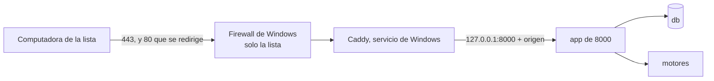

# Plan 007 · Acceso por red

Estado: propuesto (versión 3, mínima, por decisión del responsable del 2026-10-14) · Fecha: 2026-10-14 · Aprobó: —

Spec: `specs/007-acceso-por-red/spec.md` (aprobada el 2026-10-14; enmendada el mismo día, versión mínima)

ADR de este plan:

- **Propuestos:**
  - `docs/adr/0061-intermediario-cifrado-en-windows-y-lista-por-direccion.md`
  - `docs/adr/0062-certificado-en-dos-variantes-con-los-mismos-archivos.md`
  - `docs/adr/0063-bloqueo-sesion-y-cambio-de-clave-con-django.md` (enmienda el ADR-0005 en la clave olvidada)
- **Rechazado:** `docs/adr/0064-instancia-del-piloto-y-gpu-para-una-instancia-a-la-vez.md` (versión mínima: una sola instancia).

Esta versión reemplaza a la 2. Lo que la 2 agregaba y la spec no pide está en `tasks.md`, «Revisión con el primer producto».

## Resumen del enfoque

La decisión del responsable: «el sistema aun no ha sido probado y estamos poniendo mil trabas de seguridad. Ahora es una perdida de tiempo.» y «si» a una versión mínima. En consecuencia:

**Una sola instancia, la de siempre (8000), abierta a la red para la Comisión.** No hay segunda instancia ni préstamo del motor: la prueba con el caso chico usa la GPU de 8000 como hoy.

**Red (REQ-109, REQ-110, REQ-116).**

- **Por qué en Windows.** Docker Desktop no les pasa a los contenedores la dirección de quien se conecta (ADR-0061). Para registrar la computadora de origen (REQ-113), el cifrado lo hace **Caddy en Windows**, instalado como servicio.
- **Qué hace Caddy:**
  - atiende 80 y 443;
  - cifra con un certificado de `C:\EVALUON-red\`;
  - redirige `http` a `https` sin mostrar contenido;
  - corta la conexión de toda computadora que no esté en la lista;
  - pasa el pedido a `127.0.0.1:8000` con la dirección y el nombre de la computadora.
- **Firewall:** el de Windows deja entrar a 80 y 443 solo desde la lista.
- **Nada cambia en Docker:** la aplicación sigue publicada solo en `127.0.0.1`, y la base y los motores siguen en la red interna. Por eso REQ-116 se cumple sin tocar Docker.
- **La lista:** está en el `.env` de 8000, y un solo script de administrador la aplica.
- **El certificado:** son dos archivos, de una autoridad propia que solo sirve para EVALUON, o del área de sistemas (ADR-0062).

**Acceso (REQ-111 a REQ-115).** Con lo que trae Django (ADR-0063):

- un backend que bloquea 15 minutos tras 5 fallidos seguidos, para la pantalla y los comandos;
- el registro de accesos con la computadora de origen;
- `desbloquear_usuario`, `ver_accesos` y `clave_inicial` en el equipo;
- el cambio de clave de Django con el mínimo de 8 y el validador de claves comunes;
- la clave inicial obligatoria;
- un middleware que cierra la sesión a los 30 minutos sin uso y a las 8 horas, sin contar como uso el sondeo ni las tres recargas automáticas.

**Orden.** Primero el corte vertical (T-269): el ingreso servido cifrado a una computadora de la lista, con un usuario de prueba y el caso chico. Después el acceso (T-270 y T-271) y la prueba en la red con el caso chico (T-272).

## Despliegue y proceso reservado (P11)

El despliegue de la 007 en 8000 lo aprueba el responsable. El proceso en curso, reservado, se carga en 8000 solo después de dos cosas: el dictamen de la auditoría de la feature (solo fallas, ADR-0052) sin hallazgos bloqueantes, y esa aprobación. Hasta entonces, 8000 tiene solo material público.

## Criterio de aceptación numérico y umbrales (escritos antes de medir)

Criterio de la feature (spec, literal): «desde una computadora de la lista, el recorrido del caso chico (procedimiento, pliego y matriz, ofertas, evaluación y dictamen, normativas) se completa en 5 de 5 secciones, con 0 páginas servidas sin cifrar y 0 advertencias del navegador; desde una computadora fuera de la lista, 0 páginas; y desde cualquier computadora de la red, 0 conexiones aceptadas por los servicios internos».

Corte vertical (spec, literal): «primero una sola pantalla (el ingreso) servida cifrada a una computadora de la lista, con un usuario de prueba y el caso chico público; después el resto». Es T-269.

| Qué | Umbral | Cómo se mide | Tarea |
|---|---|---|---|
| Ingreso cifrado (corte vertical) | Desde la computadora de la lista (A), el usuario de prueba ingresa por `https://` con 0 advertencias y abre el caso chico | El responsable en el navegador | T-269 |
| Páginas sin cifrar (REQ-110) | 0: `http://` termina en `https://` con una redirección de Caddy, sin contenido de la aplicación | `curl.exe -sI http://<dirección>/…` | T-269, T-272 |
| Clave legible en el tráfico (REQ-110) | 0 apariciones | Captura con `pktmon` en el equipo durante un ingreso, convertida con `pktmon etl2pcap`, y búsqueda de la clave | T-269 |
| Computadora fuera de la lista (REQ-109) | 0 páginas. Una computadora que se agrega con el paso del runbook llega sin tocar el código | Navegador desde B; agregar y quitar A | T-269, T-272 |
| Servicios internos (REQ-116) | 0 conexiones aceptadas en 5432, 8000, 8080 y 2019 | `Test-NetConnection <dirección> -Port N` desde A y desde B | T-269, T-272 |
| Recorrido del caso chico (REQ-109) | 5 de 5 secciones con un usuario evaluador | El responsable desde A, con la lista del testeador | T-272 |
| Bloqueo, desbloqueo y registro (REQ-111 a REQ-113) | Los criterios de la spec, uno por uno; los 4 hechos del registro con usuario o nombre, computadora (o «equipo del sistema» para el desbloqueo), fecha y hora | Tests; una vez desde A y el equipo | T-270, T-272 |
| Clave (REQ-114) | Los criterios de la spec; además, la clave nueva igual a la actual se rechaza (si no, no se «cambia») | Tests; una vez desde A | T-271, T-272 |
| Sesión (REQ-115) | 30 minutos sin uso y 8 horas llevan al ingreso; lo guardado sigue; el sondeo y las tres recargas automáticas no cuentan; cerrar y reabrir el navegador lleva al ingreso | Tests, uno por pantalla que se recarga; desde A, 31 minutos de espera y el cierre del navegador real | T-271, T-272 |
| Tiempo de carga (no funcional) | Cada sección carga en menos de 2 s desde A, y no más lenta que en el equipo | Herramientas del navegador, en A y en el equipo | T-272 |

Rondas (ADR-0024 y ADR-0025): si T-269 o T-272 no llegan a un umbral, una sola tarea de corrección (ID nuevo que asigna el Coordinador) y una sola repetición. Lo que siga sin llegar va a «Revisión con el primer producto», salvo que se pierda un requisito o se viole un principio.

## Definiciones compartidas

**Variables nuevas del `.env` de 8000**, con un bloque comentado en `.env.example`:

- `EVALUON_ADDRESS`: el nombre o la IPv4 con que se entra.
- `EVALUON_SERVER_IP`: IPv4 fija del equipo.
- `EVALUON_COMPUTERS`: `nombre=dirección` separados por comas, IPv4, sin repetidos, **10 como máximo**.

La dirección se suma también a la variable existente `DJANGO_ALLOWED_HOSTS`.

**Carpeta:** `C:\EVALUON-red\`, fuera del repositorio. Guarda `caddy.exe`, `Caddyfile`, `certificados\evaluon.crt` y `evaluon.key`, y `autoridad\` (la autoridad propia, que se usa solo para renovar).

**Encabezados que pone Caddy** (pisan lo que mande el navegador):

- `X-Forwarded-For`: Caddy ignora el valor que traiga el cliente.
- `X-Forwarded-Proto: https`.
- `X-Evaluon-Computer`: el nombre en la lista, o `equipo-del-sistema`.

La aplicación solo es alcanzable desde el propio equipo (`127.0.0.1:8000`), así que los toma tal cual. Un pedido sin ellos vino directo al puerto local y se registra como `equipo-del-sistema`.

**Pedidos que no cuentan como uso:**

- el sondeo (`recorrido.js`), que manda el encabezado `X-Evaluon-Poll: 1`;
- las tres recargas automáticas, que llevan `auto=1` en la dirección:
  - `journey/nuevo.html` y `journey/s1_pliego_borrador.html`, por `meta refresh`;
  - `journey/s3_ofertas.js`, por script.

**Esquema (solo T-270):**

- `accounts_user` suma `failed_logins`, `locked_until` y `must_change_password`;
- `audit_event` suma los tipos de hecho `logout`, `lockout`, `unlock`, `password_change` e `initial_password`;
- el origen va en `detail["origin"] = {"computer", "ip"}`.

**Constantes:** `LOGIN_FAILURE_LIMIT = 5` y `LOGIN_LOCKOUT_MINUTES = 15` (T-270); `SESSION_IDLE_MINUTES = 30` y `SESSION_MAX_HOURS = 8` (T-271).

**Comandos nuevos**, con `--usuario` y la clave de EVALUON, y el rol de lectura y escritura, como ya hace `rol_comision`:

- `desbloquear_usuario <usuario>` y `ver_accesos [--desde] [--hasta] [--de]` (T-270);
- `clave_inicial <usuario>` (T-271).

## Componentes

| Parte | Qué cambia | Tarea |
|---|---|---|
| Caddy en Windows (`C:\EVALUON-red\`, servicio `EVALUON-Caddy`) | Nuevo. Lo indispensable para que funcione y no exponga: • `admin off`: sin API de administración local, que no pide clave; se recarga reiniciando el servicio • `auto_https off`, con el sitio `http` escrito a mano: corta lo que no está en la lista y redirige el resto • sitio `https` con los dos archivos del certificado, el mismo corte, el nombre de la computadora y el reenvío a `127.0.0.1:8000` • `default_sni` si se entra por IP, porque si no, el navegador no recibe el certificado | T-269 |
| Firewall de Windows | Una regla de entrada: TCP 80 y 443, solo `caddy.exe`, solo desde la lista y el equipo, en todos los perfiles (la red del organismo puede figurar como «Pública»). El HTTP/3 de Caddy (UDP) queda cerrado por no tener regla | T-269 |
| `scripts/red/` | `caddy.py` arma el `Caddyfile` desde el `.env` y valida la lista. `aplicar-red.ps1`, como administrador, la primera vez baja Caddy (versión fijada, comprobada con su suma SHA-512) y lo registra como servicio; siempre arma el `Caddyfile`, aplica la regla y reinicia el servicio. `crear-certificados.sh` crea la autoridad propia y el certificado | T-269 |
| `evaluon/settings.py` y un middleware | Django toma el protocolo de `X-Forwarded-Proto`. Las cookies de sesión y CSRF salen `Secure` solo en los pedidos que llegaron cifrados, para que el uso local por `http://127.0.0.1:8000` (agentes y responsable) siga andando | T-269 |
| `evaluon/accounts/` y `evaluon/audit/` | Bloqueo, origen, salida registrada, comandos, cambio de clave, clave inicial, cierre de sesión. `FORBIDDEN_DETAIL_KEYS` suma `old_password`, `new_password1` y `new_password2` (el registro nunca guarda claves) | T-270, T-271 |
| Pantallas | Enlace «Cambiar clave» y su pantalla. Las recargas suman `auto=1` y el sondeo, su encabezado, sin cambio visible | T-271 |
| Docker, base, motores, secciones | Sin cambios | — |

El camino de pliegos y ofertas no depende de servicios externos (P4). Caddy es local, no pide certificados a internet y reenvía a `127.0.0.1`; la IA es la de siempre. Bajar Caddy es el único paso con internet, una vez.

## Modelo de datos

Una sola tarea toca el esquema (T-270):

- `accounts_user`:
  - `failed_logins`: 0 por omisión;
  - `locked_until`: vacía por omisión;
  - `must_change_password`: falso por omisión; la ponen `crear_usuario` y `clave_inicial`.
- `audit_event`: los cinco tipos nuevos, con la restricción reemplazada como en la migración `audit 0008`.

La sesión guarda el momento del ingreso, el del último uso y el origen, sin tablas nuevas.

## Flujo de IA

No aplica: no cambian recuperación, instrucciones ni modelo.

## Registro de auditoría

| Hecho | Cuándo | Detalle |
|---|---|---|
| `login`, `login_failed` (existen) | Ingreso correcto o fallido, por pantalla o comando | `origin`. `login_failed` lleva el nombre tal como se escribió y no dice el motivo |
| `lockout` | Al quinto fallido seguido | `origin`, `locked_until` |
| `unlock` | `desbloquear_usuario`, o `clave_inicial` sobre un usuario bloqueado | Quién (el usuario del comando), a quién, `origin` = `equipo-del-sistema` |
| `logout` | «Salir» y el cierre por inactividad o por las 8 horas, cuando el usuario vuelve y el sistema lo detecta | `origin`, `reason` (`user`, `idle`, `max_age`) |
| `password_change` | Cambio de clave | `origin` |
| `initial_password` | `clave_inicial` | Quién y a quién |

`ver_accesos` los lista con fecha y hora, hecho, usuario o nombre, computadora con su dirección, y canal.

## Elecciones del planificador

Por la regla del responsable: sin decisiones nuevas, lo más simple que cumple la spec.

- **Responsable del sistema:** el usuario con rol de lectura y escritura, con su usuario y clave en cada comando, como ya hace `rol_comision`. Así queda registrado «quién» (REQ-112).
- **Salida:** se registra «Salir» y el cierre de una sesión vencida cuando el usuario vuelve. Una sesión que vence y nadie retoma no deja hecho.
- **Bloqueo:**
  - la decisión se toma dentro de una transacción con la fila del usuario bloqueada (`select_for_update`);
  - el backend propio es el único de `AUTHENTICATION_BACKENDS`: con `ModelBackend` en la lista, una clave correcta entraría aunque el usuario esté bloqueado;
  - los intentos durante el bloqueo no cuentan ni lo alargan;
  - el bloqueo no cierra sesiones ya abiertas.
- **Clave inicial:** frena también los comandos hasta cambiarla por pantalla (es el «primer ingreso» de REQ-114). `clave_inicial` desbloquea si el usuario estaba bloqueado.
- **Clave olvidada:** se resuelve con `clave_inicial` (la spec: «el responsable le asigna una clave inicial nueva»). El runbook deja de indicar `changepassword` (ADR-0063 enmienda el ADR-0005 en ese punto).
- **Certificado:** se empieza con la autoridad propia, limitada a la dirección de EVALUON y a uso de servidor. Esa limitación son dos líneas de configuración, y evita que la raíz instalada en las computadoras del organismo sirva para otra cosa (ADR-0062).
- **Cookies seguras:** solo en los pedidos cifrados, para no romper el uso local de 8000.

## Pasos del responsable

`specs/007-acceso-por-red/entorno.md` (T-269) los deja con cada comando y lo que tiene que verse. En corto:

1. Pedir al área de sistemas lo de la sección siguiente.
2. En la notebook:
   - que Docker Desktop arranque al iniciar sesión;
   - que no se suspenda enchufada;
   - bloquear la sesión de Windows, no cerrarla.
3. Crear el certificado propio, una vez, en Git Bash: `bash scripts/red/crear-certificados.sh`.
4. Completar en el `.env` la dirección, la IP del equipo y la lista de computadoras.
5. Correr `scripts\red\aplicar-red.ps1` en PowerShell como administrador.
6. En cada computadora de la lista, instalar una vez la raíz `ca-evaluon.crt` (necesita administrador o el área de sistemas), y guardar el acceso a `https://<dirección>`.
7. Para agregar o quitar una computadora, o poner el certificado del organismo: editar el `.env` (o reemplazar los dos archivos) y repetir el paso 5.

## Pedido al área de sistemas

1. Permiso para conectar la notebook a la red del organismo, por cable, y que las computadoras de la Comisión lleguen a ella por TCP 443 y 80.
2. Dirección fija para la notebook y, si se puede, un nombre en el DNS interno.
3. Direcciones fijas para las computadoras de la Comisión (hasta 10).
4. Que la dirección de EVALUON quede fuera del proxy web y de la inspección de conexiones cifradas del antivirus.
5. Que instalen la raíz de EVALUON en esas computadoras (o den permiso), o, si prefieren, un certificado propio del organismo para esa dirección.
6. Qué navegador usa la Comisión, y que no restaure la sesión al reabrir.

## REQ-117: qué se hará al terminar la estabilización

Mientras dura la estabilización, el piloto usa 8000 (spec enmendada), con el proceso reservado cargado después de la auditoría y de la aprobación del despliegue. Desde el principio rige lo que REQ-117 pide «en cualquier momento»: nada del proceso va al repositorio ni a las pruebas, y la IA es la local. Los respaldos de 8000 que lo contengan quedan fuera del repositorio, como hoy (`backups/` está en `.gitignore`).

Cuando el responsable dé por terminada la estabilización, un plan nuevo de esta feature lo separa:

- crea la instancia del piloto con su propio proyecto de Compose, carpeta, base, secretos y respaldos, con el procedimiento de T-049 y su `COMPOSE_PROJECT_NAME`;
- lleva a ella la base con el proceso;
- lo quita de 8000 y de sus respaldos;
- resuelve cómo se reparte la GPU entre las dos instancias (lo estudiado en el ADR-0064, rechazado para esta versión);
- cierra el acceso de los agentes: reglas de denegación y claves nuevas.

## Cobertura de requisitos

| Requisito | Cómo se resuelve | Cómo se verifica |
|---|---|---|
| REQ-109 | Caddy y el firewall con la lista del `.env`; misma aplicación, pantallas y roles | Tests del generador (lista, tope de 10, corte); T-269; T-272 |
| REQ-110 | Cifrado en Caddy; redirección sin contenido; cookies seguras en los pedidos cifrados | Tests; T-269 (advertencias, redirección, captura) |
| REQ-111 | Backend de bloqueo, mismo mensaje, pantalla y comandos | Tests con reloj y por comando; T-272 |
| REQ-112 | `desbloquear_usuario` en el equipo, con quién y cuándo | Tests; T-272 |
| REQ-113 | Origen desde los encabezados de Caddy; salida registrada; `ver_accesos` | Tests de los hechos; T-272 (los 4 hechos) |
| REQ-114 | Cambio de clave de Django con mínimo 8, claves comunes y distinta de la actual; clave inicial obligatoria; `clave_inicial` | Tests; T-272 |
| REQ-115 | Middleware de 30 minutos y 8 horas; sondeo y recargas sin contar; cookie de sesión del navegador | Tests por pantalla; T-272 con el navegador real |
| REQ-116 | Docker sin cambios (todo en `127.0.0.1` o en la red interna); solo Caddy escucha hacia la red, en TCP 80 y 443 | T-269 y T-272, con `Test-NetConnection` |
| REQ-117 | Durante la estabilización: nada al repositorio ni a las pruebas, IA local. La separación, al terminarla (sección anterior) | T-272: lo que se puede comprobar ahora |

## Verificación contra la constitución

| Principio | Cumple | Nota |
|---|---|---|
| P1 | sí | Solo lo que pide la spec enmendada; las elecciones simples están escritas arriba |
| P4 | sí | Camino local; nada reservado en el repositorio; la separación completa, al terminar la estabilización (spec enmendada y ADR-0060) |
| P5 | sí, con nota | 8000 se sigue levantando con `docker compose up -d`. Caddy se instala una vez con `aplicar-red.ps1` y arranca solo como servicio |
| P6 | sí | Cada hecho de acceso con usuario o nombre, computadora, fecha y hora; el registro no guarda claves |
| P10 | sí | Una pieza nueva (Caddy), que exige Docker Desktop; lo demás con Django |
| P11 | sí | El despliegue lo aprueba el responsable; el proceso reservado se carga después de la auditoría y de esa aprobación |

## Riesgos

| Riesgo | Mitigación |
|---|---|
| El área de sistemas no fija las direcciones, o los pedidos pasan por un proxy | Pedidos 2 a 4; si no se puede, la alternativa del certificado por computadora (ADR-0061) |
| Alguien toma la dirección de una computadora de la lista | Igual necesita usuario y clave. El registro lo anotaría con el nombre de esa computadora |
| El navegador restaura la sesión al reabrir | Pedido 6. Queda el cierre a los 30 minutos |
| El proceso reservado convive en 8000 con la construcción durante la estabilización | Es lo que decidió el responsable (spec enmendada, ADR-0060). La separación, al terminar |
| Lo que la versión 2 endurecía y aquí no se hace | Lista de «Revisión con el primer producto», para cuando el sistema esté probado |
