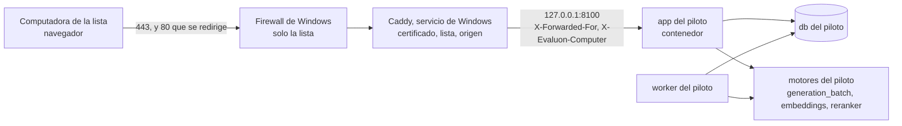

# Plan 007 · Acceso por red

Estado: propuesto · Fecha: 2026-10-14 · Aprobó: —

Spec: `specs/007-acceso-por-red/spec.md` (aprobada el 2026-10-14)

ADR de este plan, **propuestos**: `docs/adr/0061-intermediario-cifrado-en-windows-y-lista-por-direccion.md`, `docs/adr/0062-certificado-en-dos-variantes-con-los-mismos-archivos.md`, `docs/adr/0063-bloqueo-sesion-y-cambio-de-clave-con-django.md` y `docs/adr/0064-instancia-del-piloto-y-gpu-para-una-instancia-a-la-vez.md`. Se apoya en el ADR-0005 (Django 6.1, sesiones en la base, Argon2id, comandos con usuario y clave), el ADR-0057 (configuración de uso con el 27B), el ADR-0060 (excepción de P4 durante la estabilización) y en T-049 de la 001 (instalación desde cero).

## Resumen del enfoque

Tres frentes que casi no se tocan entre sí.

1. **Red (REQ-109, REQ-110, REQ-116).** Un hecho del equipo condiciona todo: Docker Desktop no les pasa a los contenedores la dirección de la computadora que se conecta; dentro del contenedor todas llegan con una dirección interna de Docker (ADR-0061, fuentes 1 a 3). Si el cifrado y la lista se resolvieran dentro de Docker, la aplicación no podría registrar desde qué computadora entró cada uno (REQ-113). Por eso el plan pone delante de la aplicación un **intermediario que corre en Windows**, Caddy 2.11, instalado una vez como servicio. Atiende los puertos 80 y 443 hacia la red, cifra con el certificado de una carpeta, redirige lo que llega sin cifrar, corta la conexión de toda computadora que no está en la lista, le agrega al pedido la dirección y el nombre de la computadora y lo pasa a la aplicación por `127.0.0.1`. **Docker sigue sin publicar nada hacia la red**: la aplicación del piloto se publica solo en `127.0.0.1:8100`, y la base y los motores siguen en la red interna. El firewall de Windows deja entrar a los puertos 80 y 443 solo desde la lista; el intermediario vuelve a controlarla. La lista vive en el `.env` de la instancia del piloto (hasta 10 computadoras, `nombre=dirección`) y un script la aplica al firewall y al intermediario: agregar o quitar una computadora no toca el código. El certificado son dos archivos en una carpeta; los produce un script con una autoridad propia o los entrega el área de sistemas, y pasar de una variante a la otra es reemplazar los archivos y recargar (ADR-0062).

2. **Acceso (REQ-111 a REQ-115).** Con lo que trae Django, sin bibliotecas nuevas (ADR-0063): un backend de ingreso que cuenta los intentos fallidos por usuario y bloquea 15 minutos tras 5 seguidos, que vale igual para la pantalla y para los comandos porque los dos ya pasan por `authenticate`; la vista de cambio de clave de Django con el validador de claves comunes; una marca de clave inicial en el usuario; un middleware que cierra la sesión a los 30 minutos sin uso y a las 8 horas de iniciada, sin contar como uso el sondeo de la pantalla; el registro de accesos en `audit_event` con la computadora de origen; y tres comandos para el responsable del sistema (desbloquear, ver el registro, asignar una clave inicial).

3. **Instancia del piloto (REQ-117).** Un segundo proyecto de Docker Compose (`evaluon-piloto`) en una carpeta propia fuera del perfil de usuario (`C:\EVALUON-piloto\`), con base, volúmenes, imagen, puerto, respaldos, secretos y motores propios (ADR-0064). No entran dos 27B en la GPU, pero sí el 27B de una instancia con embeddings y reranker de las dos: T-049 midió 20.940 MiB de 24.463. Por eso **el motor de generación (el 27B) lo tiene una sola instancia a la vez**, y embeddings y reranker quedan siempre encendidos en las dos. Mientras el piloto tiene el motor, la construcción trabaja sin él (código y tests, que no lo usan) y mide cuando el responsable se lo pasa. La IA del piloto es la local, con la configuración adoptada en el ADR-0057. La instalación sigue el procedimiento que deja T-049 de la 001. Todas las órdenes de Docker en la carpeta del piloto pasan por un script que fija el nombre del proyecto: si faltara, el `name: evaluon` del compose haría que una orden en esa carpeta actuara sobre 8000 (hallazgo de T-049).

Orden: primero el **corte vertical** (T-269 a T-271: el ingreso servido cifrado a una computadora de la lista, con un usuario de prueba, sobre una instancia que solo tiene material público); después, en paralelo, el acceso (T-272 a T-275) y la instancia del piloto (T-276); al final, la prueba de aceptación en la red con el caso chico (T-278).

## Criterio de aceptación numérico y umbrales (escritos antes de medir)

Criterio de la feature (spec, literal): «desde una computadora de la lista, el recorrido del caso chico (procedimiento, pliego y matriz, ofertas, evaluación y dictamen, normativas) se completa en 5 de 5 secciones, con 0 páginas servidas sin cifrar y 0 advertencias del navegador; desde una computadora fuera de la lista, 0 páginas; y desde cualquier computadora de la red, 0 conexiones aceptadas por los servicios internos».

Corte vertical (T-269 a T-271): el ingreso servido cifrado a una computadora de la lista, con un usuario de prueba, en una instancia sin material reservado. El caso chico (`tests/assessment/data/caso-chico/`, público) se recorre entero en T-278, porque la matriz y la evaluación necesitan la GPU.

| Qué | Umbral | Con qué se mide | Tarea |
|---|---|---|---|
| Recorrido del caso chico desde una computadora de la lista (REQ-109) | 5 de 5 secciones completas con un usuario evaluador, igual que en el equipo del sistema | El responsable recorre en el navegador siguiendo la lista del testeador, que anota cada sección | T-278 |
| Páginas sin cifrar (REQ-110) | 0: toda dirección `http://` termina en `https://` con una redirección del intermediario, sin cuerpo de la aplicación | `curl -sI` por `http://` al ingreso, a una página de cada sección y a un estático; el navegador | T-271 (ingreso), T-278 (todas) |
| Advertencias del navegador (REQ-110) | 0 en cada computadora de la lista que se prueba, con el navegador que usa la Comisión | Abrir la dirección; captura de la barra de direcciones | T-271, T-278 |
| Clave legible en el tráfico de un ingreso (REQ-110) | 0 apariciones de la clave en la captura | Captura con `pktmon` (incluido en Windows) o Wireshark en el equipo del sistema durante un ingreso; búsqueda del texto de la clave en el archivo | T-271 |
| Computadora fuera de la lista (REQ-109) | 0 páginas por `http` y por `https` (la conexión no se establece o se corta sin respuesta); una computadora que se saca y se vuelve a poner con el script llega sin tocar el código | Navegador y `scripts/red/revisar-puertos.ps1` desde una computadora fuera de la lista | T-271, T-278 |
| Servicios internos (REQ-116) | 0 conexiones aceptadas desde la red, desde una computadora de la lista y desde una de fuera | `scripts/red/revisar-puertos.ps1`: 5432, 8000, 8080, 8100, 2019 (administración de Caddy) y 2375 (Docker) | T-271 (primera vez), T-278 |
| Bloqueo (REQ-111) | Tras 5 fallidos seguidos, el intento con la clave correcta se rechaza con el mismo mensaje durante 15 minutos y después ingresa; con 4 fallidos y uno correcto ingresa y la cuenta vuelve a 0; 3 de 3 mensajes idénticos (inexistente, clave equivocada, bloqueado); lo mismo por comando | Tests con el reloj controlado; una vez desde otra computadora | T-272, T-278 |
| Desbloqueo y registro (REQ-112, REQ-113) | Ingresa enseguida tras el desbloqueo; el registro muestra 4 de 4 hechos (ingreso, intento fallido, bloqueo, desbloqueo) con usuario o nombre escrito, computadora de origen, fecha y hora, y el desbloqueo con quién | Tests; `ver_accesos` después de la prueba desde otra computadora | T-273, T-278 |
| Cambio de clave (REQ-114) | Con clave inicial, 0 secciones usables hasta cambiarla; clave nueva corta o común, rechazada con el motivo; sin la clave actual correcta, rechazada | Tests; una vez desde otra computadora | T-275, T-278 |
| Inactividad (REQ-115) | A los 30 minutos sin uso, el siguiente pedido lleva al ingreso; a las 8 horas de iniciada, también; después de ingresar, lo guardado sigue; el sondeo de la pantalla no cuenta como uso | Tests con el reloj controlado; una vez real desde otra computadora (31 minutos de espera) | T-274, T-278 |
| Carga (no funcional) | Con 10 sesiones a la vez, el p95 de carga de cada página de las secciones es menor que 2 s y su mediana no supera en más de 0,3 s la mediana con una sola sesión en el equipo del sistema; sin contar la Consulta ni los pedidos en segundo plano | `scripts/red/medir_carga.py` (T-277) por el intermediario, más una carga por sección desde una computadora de la lista con las herramientas del navegador | T-278 |
| Instancia separada (REQ-117) | 0 tareas de construcción (tests, mediciones, respaldos, verificaciones) que usen el proyecto, la base, los volúmenes, los respaldos o la carpeta del piloto; 0 archivos del proceso en curso en el repositorio; IA del piloto solo local | `docker compose config` de las dos instancias; búsqueda de los nombres del piloto en los scripts y comandos de construcción; `git status` del clon del piloto limpio y sin remoto de escritura; servicios del piloto con `--offline` y direcciones internas | T-276, T-278 |

Rondas (ADR-0024 y ADR-0025): T-278 es la ronda 1. Si algo no llega, T-279 corrige todo en una sola tarea y repite solo lo que falló (ronda 2). Lo que siga sin llegar pasa con su impacto a la lista de revisión con el primer producto, salvo que se pierda un requisito o se viole un principio. La forma de leer «sin que una página tarde más que en el equipo del sistema» (mediana con 10 sesiones a no más de 0,3 s de la mediana con una sola en el equipo) es una propuesta del planificador: la confirma el Coordinador antes de T-278.

## Definiciones compartidas

Fijas antes de paralelizar. Una tarea que necesite cambiar una la deja como hallazgo y decide el Coordinador.

**Variables del `.env` de la instancia del piloto** (bloque comentado en `.env.example`, T-269; los nombres son identificadores y van en inglés):

| Variable | Valor | La lee |
|---|---|---|
| `COMPOSE_PROJECT_NAME` | `evaluon-piloto` | Docker Compose |
| `COMPOSE_FILE` | la de uso de `.env.example` más `:docker-compose.piloto.yml` | Docker Compose |
| `APP_PORT` | `8100` | compose (ya existe: `127.0.0.1:${APP_PORT}:8000`) y el generador del intermediario |
| `EVALUON_HTTPS` | `true` (en construcción falta y vale `false`) | `settings.py` |
| `DJANGO_ALLOWED_HOSTS` | la dirección fija, `localhost,127.0.0.1` | `settings.py` (ya existe) |
| `EVALUON_ADDRESS` | la dirección fija con que se entra: nombre del DNS interno o dirección IPv4 del equipo | generador del intermediario |
| `EVALUON_SERVER_IP` | dirección IPv4 fija del equipo del sistema en la red del organismo | generador del intermediario |
| `EVALUON_COMPUTERS` | lista `nombre=dirección` separada por comas; nombres con minúsculas, números y guiones; direcciones IPv4; sin repetidos; **10 como máximo** | generador del intermediario y script del firewall |

**Encabezados que el intermediario pone en cada pedido** (pisan lo que mande el navegador): `X-Forwarded-For` (dirección de la computadora; Caddy ignora el valor que venga del cliente), `X-Forwarded-Proto: https` y `X-Evaluon-Computer` (nombre de la computadora en la lista, o `equipo-del-sistema`). La aplicación solo es alcanzable desde el propio equipo (`127.0.0.1`), así que confía en ellos. Sin esos encabezados, el pedido vino directo por el puerto local.

**Encabezado del sondeo:** `X-Evaluon-Poll: 1`, que manda `recorrido.js`; esos pedidos no cuentan como uso (T-274).

**Esquema (solo T-272):** campos de `accounts_user` `failed_logins`, `locked_until` y `must_change_password`; tipos de hecho nuevos `logout` («Salida»), `lockout` («Bloqueo por intentos fallidos»), `unlock` («Desbloqueo»), `password_change` («Cambio de clave») e `initial_password` («Clave inicial asignada»).

**Origen en el registro:** `audit_event.detail["origin"] = {"computer": <nombre>, "ip": <dirección o null>}`. `computer` es el nombre de la lista, `equipo-del-sistema` (el equipo por el intermediario, un pedido directo por el puerto local o un comando) o `desconocida` (un pedido del intermediario sin nombre, que no debería ocurrir).

**Constantes de `settings.py`:** `LOGIN_FAILURE_LIMIT = 5` y `LOGIN_LOCKOUT_MINUTES = 15` (T-272); `SESSION_IDLE_MINUTES = 30` y `SESSION_MAX_HOURS = 8` (T-274). Son literales de la spec, no variables de entorno. `SESSION_COOKIE_AGE` sigue en 8 horas y `SESSION_EXPIRE_AT_BROWSER_CLOSE` en verdadero.

**Funciones que comparten las tareas:** `evaluon.accounts.backends.register_failed_attempt(user, origin)` cuenta un fallido y bloquea al quinto, con su hecho `lockout`. La crea T-272 y la usan el backend y el formulario de cambio de clave (T-275). `evaluon.accounts.origin.request_origin(request)` devuelve el origen de un pedido y `COMMAND_ORIGIN` el de un comando; los crea T-273. El motivo de una salida lo pone el middleware de sesión en `request.evaluon_logout_reason` antes de llamar a `logout` (T-274), y el receptor de la señal de salida lo lee (T-273).

**Comandos nuevos** (nombres en español, como los demás): `desbloquear_usuario <usuario> --usuario <responsable>`, `ver_accesos [--desde AAAA-MM-DD] [--hasta AAAA-MM-DD] [--de <usuario>] --usuario <responsable>` y `clave_inicial <usuario> --usuario <responsable>`. Los tres exigen el rol de lectura y escritura, como `rol_comision` (ver «Puntos para el responsable», 4).

**Instancia del piloto:** proyecto `evaluon-piloto`; imagen `evaluon-app:piloto`; puerto `127.0.0.1:8100`; carpeta `C:\EVALUON-piloto\` con `evaluon\` (clon), `caddy\` (ejecutable y `Caddyfile`), `certificados\` (`evaluon.crt` y `evaluon.key`), `respaldos\`. Archivos de compose: `docker-compose.piloto.yml` (piloto: nombre del proyecto e imagen) y `docker-compose.sin-gpu.yml` (construcción mientras el piloto tiene el motor: `generation_batch` y `worker` en el perfil `gpu`). Toda orden de Docker en la carpeta del piloto pasa por `scripts/piloto/compose.ps1` (T-269). El script comprueba que el `.env` tenga `COMPOSE_PROJECT_NAME=evaluon-piloto` y que `COMPOSE_FILE` incluya `docker-compose.piloto.yml`, y llama a `docker compose -p evaluon-piloto`. Si algo no está, no hace nada. Los demás scripts del piloto lo usan.

## Componentes

| Parte | Cambia | Qué cambia | Tarea |
|---|---|---|---|
| Intermediario cifrado: Caddy 2.11 en Windows, como servicio | Nuevo, fuera de Docker | Termina el cifrado con los archivos de `certificados\`; redirige `http` a `https`; corta las conexiones que no vienen de la lista (`remote_ip`); pone los encabezados de origen; reenvía a `127.0.0.1:8100`. Sin certificados automáticos ni consultas a internet | T-270 |
| Firewall de Windows | Regla nueva | Entrada TCP 80 y 443 para el ejecutable de Caddy, solo desde las direcciones de la lista, perfiles de dominio y privado; desactiva otras reglas de entrada de ese ejecutable | T-270 (script); la aplica el responsable |
| `scripts/red/` | Nuevo | Generador del `Caddyfile` desde el `.env` (Python, sin bibliotecas), plantilla, aplicación de la lista al firewall y al intermediario, instalación de Caddy con versión y huella fijas, certificados propios, medición de carga, revisión de puertos | T-270, T-277 |
| `evaluon/settings.py` | Sí | Modo HTTPS detrás del intermediario (`EVALUON_HTTPS`: cookies seguras y encabezado de protocolo); backend de ingreso y constantes; middleware de sesión y de cambio obligatorio de clave; validador de claves comunes | T-269, T-272, T-274, T-275 |
| `evaluon/accounts/` | Sí | `backends.py` (bloqueo), `origin.py` (computadora de origen), `session_policy.py` (inactividad y tope), `password_policy.py` (cambio obligatorio), vista y plantilla de cambio de clave, comandos `desbloquear_usuario`, `ver_accesos` y `clave_inicial`; `crear_usuario` marca la clave inicial; `apps.py` registra salida y origen; `permissions.authenticate_command` registra origen y rechaza la clave inicial | T-272 a T-275 |
| `evaluon/audit/models.py` y una migración | Sí | Cinco tipos de hecho | T-272 |
| `evaluon/templates/journey/_cabecera.html` | Sí | Enlace «Cambiar clave» junto a «Salir» | T-275 |
| `evaluon/static/journey/recorrido.js` | Sí | El sondeo manda `X-Evaluon-Poll: 1` | T-274 |
| `docker-compose.piloto.yml` | Nuevo | Nombre del proyecto (`evaluon-piloto`) e imagen propia (`evaluon-app:piloto`) | T-269 |
| `docker-compose.sin-gpu.yml` | Nuevo | En construcción, mientras el piloto tiene el motor: `generation_batch` y `worker` en un perfil que no arranca | T-276 |
| `docker-compose.yml` | Entorno y montajes | `EVALUON_HTTPS` en el entorno de la imagen de la aplicación; monta los dos archivos nuevos para los tests (regla de T-264) | T-269, T-276 |
| `.env.example` | Sí | Bloque comentado de la instancia del piloto, con `COMPOSE_PROJECT_NAME` | T-269 |
| `.gitattributes` | Sí | `scripts/models.sha256` con fin de línea LF: en un clon de Windows queda con CRLF y la verificación de los modelos falla (T-049) | T-276 |
| `scripts/piloto/` | Nuevo | `compose.ps1` (toda orden de Docker del piloto, con el nombre del proyecto comprobado); pasar el motor de una instancia a la otra; respaldo del piloto en su carpeta | T-269, T-276 |
| Base, motores de IA, `worker`, `portal_worker`, pantallas de las secciones | No | — | — |

El camino de pliegos y ofertas no depende de ningún servicio externo (P4): el intermediario corre en el equipo, no pide certificados a internet y reenvía a `127.0.0.1`; la IA es la de los motores locales con `--offline`. Bajar Caddy es un paso con internet, una vez, como bajar los modelos.

## Modelo de datos

**Una sola tarea toca el esquema: T-272**, con dos migraciones que corren juntas.

- `accounts_user` (migración nueva de `accounts`):
  - `failed_logins`: entero chico no negativo, por omisión 0. Intentos fallidos seguidos desde el último ingreso correcto o desbloqueo.
  - `locked_until`: fecha y hora, vacía por omisión. Mientras sea futura, el usuario está bloqueado.
  - `must_change_password`: verdadero o falso, por omisión falso. Lo pone en verdadero `crear_usuario` y `clave_inicial`; lo vuelve a falso el cambio de clave.
  - Los usuarios que ya existen quedan con 0, vacío y falso.
- `audit_event.event_type` (migración nueva de `audit`, como la 0008): suma `logout`, `lockout`, `unlock`, `password_change` e `initial_password` a `EventType` y a la restricción `audit_event_event_type_valid`. Todos entran en los 20 caracteres del campo. No hay columnas nuevas: el origen va en `detail`, que ya existe. La tabla sigue siendo de solo inserción.
- Sesión: sin tablas nuevas. El middleware guarda en los datos de la sesión el momento del ingreso y el del último uso.

## Flujo de IA

No aplica. La feature no cambia la recuperación, las instrucciones ni el modelo, así que no hace falta correr el conjunto dorado (P7). La instancia del piloto usa la configuración de uso vigente (ADR-0057: el 27B en `generation_batch`, con razonamiento solo en el contraste y la Consulta en el mismo motor), con motores propios. Un cambio de modelo o de instrucciones llega al piloto solo con un despliegue aprobado (P11).

## Registro de auditoría

Todo va en `audit_event` (P6), nunca con la clave ni el identificador de sesión (`FORBIDDEN_DETAIL_KEYS`).

| Hecho | Cuándo | Usuario y nombre | Detalle |
|---|---|---|---|
| `login` (existe) | Ingreso correcto, por pantalla o comando | El usuario | `origin`; por comando, además, `command` |
| `login_failed` (existe) | Usuario inexistente, clave equivocada, usuario bloqueado o dado de baja; también la clave actual equivocada en el cambio de clave | Sin usuario; el nombre tal como se escribió | `origin`; en el cambio de clave, `form: password_change`. No dice el motivo: el registro no distingue inexistente de bloqueado, como el mensaje |
| `lockout` | Al quinto fallido seguido | El usuario bloqueado | `origin` del quinto intento, `locked_until` |
| `unlock` | `desbloquear_usuario`, o `clave_inicial` sobre un usuario bloqueado | Quien desbloquea | `unlocked_user`, `unlocked_user_id`, `locked_until` que tenía, `command` |
| `logout` | «Salir», y el cierre por inactividad o por las 8 horas | El usuario | `origin`, `reason` (`user`, `idle` o `max_age`) |
| `password_change` | Cambio de clave correcto | El usuario | `origin`; `initial: true` si era la clave inicial |
| `initial_password` | `clave_inicial` | Quien la asigna | `target_user`, `target_user_id`, `command` |

`ver_accesos` lista estos siete hechos con fecha y hora, hecho, usuario o nombre escrito, computadora con su dirección y canal. Una sesión que vence sin que el usuario vuelva no deja `logout`: no hay pedido en el que registrarla; la base la borra con `clearsessions`.

## Instancia del piloto (REQ-117)

**Qué separa a las dos instancias.**

| | Construcción (hoy, 8000) | Piloto |
|---|---|---|
| Carpeta | `C:\Users\snave\Documents\dev\EVALUON` y sus copias de trabajo | `C:\EVALUON-piloto\evaluon\`: un clon del repositorio en el commit desplegado, fuera del perfil de usuario y de toda carpeta sincronizada con la nube |
| Proyecto de Compose | `evaluon` | `evaluon-piloto`, por tres vías: `COMPOSE_PROJECT_NAME` en su `.env`, `name:` en `docker-compose.piloto.yml` y `scripts/piloto/compose.ps1`, que comprueba las dos antes de llamar a Docker con `-p evaluon-piloto` |
| Base y volúmenes | `evaluon_pgdata` | `evaluon-piloto_pgdata` (los toma del nombre del proyecto) |
| Imagen de la aplicación | `evaluon-app:local` | `evaluon-app:piloto`. Si compartieran la etiqueta, construir una cambiaría la imagen de la otra al recrearla |
| Puerto | `127.0.0.1:8000` | `127.0.0.1:8100`, que solo usa el intermediario |
| `.env` y secretos | propios | propios: otra `POSTGRES_PASSWORD` y otra `DJANGO_SECRET_KEY` |
| Motores de IA | propios | propios, con la misma configuración (ADR-0057). Los archivos de los modelos se copian a `models\` del clon y se verifican con `scripts/fetch_models.sh` (y `--qwen38-27b`), que con los archivos presentes solo comprueba la huella. Requiere `scripts/models.sha256` con fin de línea LF (T-276) |
| Respaldos | `backups/` de la copia de trabajo | `C:\EVALUON-piloto\respaldos\` (`scripts/piloto/respaldar.ps1`) |
| Acceso desde la red | ninguno | por el intermediario (ADR-0061) |
| Repositorio | publica por pull request | el clon no puede publicar: su `origin` no tiene dirección de envío |

**El motor de generación, para una instancia a la vez.** No entran dos 27B en la GPU. Sí entran el 27B de una instancia con embeddings y reranker de las dos: 20.940 MiB de 24.463, medido por T-049. Mientras el piloto tiene el motor, la construcción usa `docker-compose.sin-gpu.yml`: su `generation_batch` y su `worker` quedan en un perfil que no arranca (nada más los espera), así `docker compose up -d` y `docker compose run --rm app pytest` no encienden un segundo 27B. Para medir, el responsable pasa el motor a la construcción con `scripts/piloto/gpu.ps1 -Para construccion`: detiene `generation_batch` y `worker` del piloto y enciende los de construcción. Lo devuelve con `-Para piloto`. Cada cambio tarda lo que tarda en cargar el 27B (de 3 a 10 minutos) más unos 20 s en detener el otro. El script comprueba que el motor de destino responde y tiene el modelo esperado (`/health` y `/props`). No usa `nvidia-smi` como prueba de GPU libre: T-049 lo vio marcar 0 MiB con el 27B cargado. Mientras el piloto no tiene el motor, su aplicación sigue respondiendo y busca en la normativa, pero no evalúa ni arma matrices, y la Consulta avisa que no está disponible, como ya hace (T-255).

**El nombre del proyecto, una salvaguarda.** El compose base dice `name: evaluon`. Si en la carpeta del piloto faltaran `COMPOSE_PROJECT_NAME` y el archivo del piloto en `COMPOSE_FILE`, cualquier orden de Compose actuaría sobre 8000: un `down -v` borraría su base (hallazgo de T-049). Por eso el runbook del piloto no usa `docker compose` directo: usa `scripts/piloto/compose.ps1`, que comprueba las dos líneas y pasa `-p evaluon-piloto`. Los demás scripts del piloto pasan por él. Queda el riesgo de una orden escrita a mano sin el script (ver «Riesgos»).

**La imagen.** `docker-compose.piloto.yml` pone `image: evaluon-app:piloto` en los cuatro servicios de la imagen propia. Construir en una instancia no cambia la imagen de la otra, y el piloto puede quedar en una versión distinta de la construcción. Como el código se monta desde el clon, la imagen lleva solo las dependencias. Con el mismo `Dockerfile` y `pyproject.toml`, Docker reutiliza las capas que ya tiene. Una construcción sin caché hoy falla en este equipo porque Norton intercepta las conexiones cifradas de `pip` (hallazgo de T-049): queda como pendiente fuera del alcance de esta feature.

**Mediciones.** Las mediciones de construcción corren solo en la instancia de construcción, con la GPU prestada, y nunca sobre la base del piloto. Lo que el responsable decida compartir del piloto son cifras agregadas, sin textos (REQ-117): no se construye nada para eso.

**El repositorio, que es público.** El material reservado entra al piloto por la pantalla y queda en su base. El clon del piloto no puede publicar, sus respaldos van fuera del clon, y nada de la construcción lee la carpeta del piloto. Durante la estabilización (ADR-0060) los agentes pueden leer la instancia del piloto; lo que lleven al repositorio son cifras, claves y estados, como hoy.

**Los agentes, al terminar la estabilización.** T-276 deja escrito el procedimiento de cierre para que lo aplique el responsable: el Coordinador deja de dar encargos sobre el piloto; la configuración de permisos de Claude Code del equipo suma reglas que niegan leer `C:\EVALUON-piloto\` y correr Docker sobre el proyecto `evaluon-piloto`; y se cambian la clave de la base y la clave secreta del piloto. Límite conocido: con el mismo usuario de Windows y Docker Desktop, cualquier proceso de ese usuario puede entrar a los contenedores. La separación es de procedimiento, no técnica. La técnica exige otro usuario de Windows sin acceso a Docker para los agentes, u otro equipo (ADR-0064; decisión del responsable).

**Relación con T-049 de la 001.** T-049 prueba la instalación desde cero en una copia limpia con la configuración por omisión. Deja los «Datos para el runbook»: descarga de modelos, migración con respaldo previo, respaldo y restauración, limpieza de sesiones, fallas conocidas. La instancia del piloto se instala con ese procedimiento más lo propio de esta feature (T-276). El corte vertical no depende de T-049: levanta solo la base, la migración y la aplicación, sin motores (`compose.ps1 up -d db migrate` y después `compose.ps1 up -d --no-deps app`).

Hallazgos de T-049 que este plan incorpora:

- la convivencia con 8000 por `COMPOSE_PROJECT_NAME` y `APP_PORT`, y la salvaguarda del nombre del proyecto (T-269);
- la imagen propia del piloto (T-269);
- el motor que se turna, con la memoria medida y sin `nvidia-smi` como prueba (T-276, ADR-0064);
- el fin de línea de `scripts/models.sha256` (T-276);
- la intercepción de Norton en las pruebas con certificados (T-271, T-277, T-278).

Quedan fuera del alcance de esta feature, porque ningún requisito de la 007 los pide:

- la construcción de la imagen sin caché con Norton;
- separar el usuario de la aplicación del dueño del esquema en la base (el registro de solo inserción no frena `TRUNCATE`);
- la salida a internet de `app` por la red `web` (T-047).

Conviene decidirlos al desplegar el piloto (ver «Riesgos»).

## Pasos del responsable en Windows y en la red

Lo que toca Windows o la red lo hace el responsable siguiendo el runbook, no un agente. T-270 y T-276 escriben estos pasos en detalle en `specs/007-acceso-por-red/entorno.md` y `instancia-piloto.md`, con cada comando y lo que tiene que verse en la pantalla. Lo marcado **[Área de sistemas]** necesita algo del organismo.

**Una sola vez**

1. **[Área de sistemas]** Pedir lo de la sección siguiente. El corte vertical se puede hacer antes, en cualquier red con una segunda computadora, con el certificado propio.
2. Configurar la energía del equipo para que no se suspenda enchufado. Docker Desktop arranca al iniciar sesión en Windows: después de un reinicio, alguien tiene que iniciar sesión.
3. Crear la carpeta `C:\EVALUON-piloto\` y dentro el clon y su `.env` (pasos de T-049 y T-276). En esa carpeta, **nunca** escribir `docker compose` directo: siempre `scripts\piloto\compose.ps1` (por ejemplo, `.\scripts\piloto\compose.ps1 ps`). Si el `.env` no dice que es el piloto, el script no hace nada.
4. Instalar el intermediario: abrir PowerShell **como administrador** y correr `scripts\red\instalar-caddy.ps1`. Baja la versión fijada, comprueba su huella, la deja en `C:\EVALUON-piloto\caddy\` y la registra como servicio que arranca solo.
5. Certificado, según la variante:
   - **Propio:** en Git Bash, `bash scripts/red/crear-certificados.sh` con la dirección fija. Deja `evaluon.crt` y `evaluon.key` en `C:\EVALUON-piloto\certificados\` y la autoridad (`ca-evaluon.crt` y su clave) en una carpeta aparte. Guardar esa carpeta en un pendrive y sacarla del equipo: hace falta solo para renovar.
   - **Del organismo:** copiar a `C:\EVALUON-piloto\certificados\` los dos archivos que entregue el área de sistemas, con esos nombres.
6. Completar en el `.env` del piloto la dirección fija, la dirección del equipo y la lista de computadoras (`EVALUON_ADDRESS`, `EVALUON_SERVER_IP`, `EVALUON_COMPUTERS`).
7. Correr **como administrador** `scripts\red\aplicar-red.ps1`. Arma la configuración del intermediario, deja abierto el firewall solo para la lista, recarga el intermediario y muestra lo que quedó.
8. Con el certificado propio, en cada computadora de la lista: instalar `ca-evaluon.crt` una vez (doble clic, «Instalar certificado», «Equipo local», «Entidades de certificación raíz de confianza»). **[Área de sistemas]** Hace falta permiso de administrador en esa computadora, o que lo instale el área por política de grupo.
9. Comprobar desde una computadora de la lista y desde una de fuera, con `scripts\red\revisar-puertos.ps1` y el navegador (lista de T-271).

**Cada vez que cambia la lista:** editar la línea `EVALUON_COMPUTERS` del `.env` del piloto y volver a correr `aplicar-red.ps1` como administrador. No se toca el código ni se reinicia la aplicación.

**Al pasar del certificado propio al del organismo:** reemplazar los dos archivos de `certificados\` y correr `aplicar-red.ps1`. Después se puede quitar la raíz propia de cada computadora.

**Una vez por año, con el certificado propio:** volver a correr `crear-certificados.sh` con la autoridad del pendrive y después `aplicar-red.ps1`. Las computadoras no se tocan.

**Para medir en construcción:** `scripts\piloto\gpu.ps1 -Para construccion`, y al terminar `-Para piloto`. Mientras tanto el piloto no evalúa ni arma matrices.

**Desbloquear, asignar una clave inicial y ver el registro:** comandos `desbloquear_usuario`, `clave_inicial` y `ver_accesos` en la carpeta del piloto (`.\scripts\piloto\compose.ps1 exec app python manage.py …`).

## Pedido al área de sistemas

1. **Permiso para conectar el equipo del sistema** (notebook propia, Windows 11) a la red del organismo, de preferencia por cable, y que las computadoras de la Comisión lleguen a él por TCP 443 y 80 (rutas, redes virtuales y firewalls internos). En Wi-Fi, que no aísle a los clientes entre sí.
2. **Dirección fija para el equipo del sistema** (reserva de DHCP o dirección estática) y, si se puede, **un nombre en el DNS interno** (por ejemplo `evaluon.<dominio interno>`). Sin nombre, se entra por la dirección.
3. **Direcciones fijas para las computadoras de la Comisión** (hasta 10), con el nombre de cada una. La lista de EVALUON se arma con esas direcciones: si cambian, la computadora deja de llegar.
4. **Que la dirección de EVALUON quede fuera del proxy web** de los navegadores (lista de excepciones o PAC). Si los pedidos pasan por el proxy, todos llegan con la dirección del proxy: la lista y el registro de la computadora de origen dejan de servir.
5. **Certificado**, una de dos:
   - un certificado de servidor emitido por la autoridad interna del organismo, en la que las computadoras ya confían, para el nombre (o la dirección) de EVALUON: certificado con su cadena y clave privada en formato PEM (o PFX, que se convierte), con su fecha de vencimiento y cómo se renueva; o
   - que instalen la raíz propia de EVALUON en las computadoras de la lista por política de grupo, o que den permiso para instalarla, y que el antivirus o el EDR no lo bloqueen (instalar una raíz es algo que esas herramientas vigilan).
6. **Qué navegador y qué versión usa la Comisión.** Edge y Chrome usan los certificados de Windows; Firefox puede necesitar un paso más.
7. **Si el antivirus o el proxy de las computadoras de la Comisión inspecciona las conexiones cifradas**, que exceptúe la dirección de EVALUON. En el equipo del sistema, Norton lo hace (T-049): si un producto así se pone en el medio, el navegador ve su certificado y no el de EVALUON, y puede mostrar advertencias o bloquear.
8. **Que los navegadores no restauren la sesión al reabrir** («continuar donde lo dejaste»), por política. Si la restauran, la sesión no se cierra al cerrar el navegador; queda el cierre a los 30 minutos sin uso (REQ-115).
9. Si el equipo recibe políticas de firewall del dominio: que la regla local de entrada se aplique, o que la creen ellos con los mismos datos.

Fuera del área de sistemas, el ADR-0060 recomienda la conformidad del área legal o de seguridad para que ofertas reservadas pasen por un servicio de IA en la nube durante la estabilización. No la puede dar el proyecto.

## Cobertura de requisitos

| Requisito | Cómo se resuelve | Cómo se verifica |
|---|---|---|
| REQ-109 | Intermediario en Windows con la lista por dirección fija, en el firewall y en el intermediario; la lista en el `.env` del piloto, aplicada por script, sin tocar el código (T-270, ADR-0061); la aplicación del piloto es la misma, con las mismas pantallas y roles (T-269, T-276) | Tests del generador (lista, tope de 10, corte de lo que no está en la lista); T-271 (computadora de la lista, de fuera, y una que se saca y se vuelve a poner); T-278 (5 de 5 secciones) |
| REQ-110 | Cifrado en el intermediario con el certificado de la carpeta (ADR-0062); redirección de `http` por el intermediario; modo HTTPS de Django (cookies seguras, protocolo del intermediario) (T-269) | Tests del modo HTTPS y del `Caddyfile` generado; T-271 (0 advertencias, redirección sin contenido, captura sin la clave); T-278 (todas las páginas) |
| REQ-111 | Backend de ingreso con contador por usuario y bloqueo de 15 minutos tras 5 seguidos, mismo mensaje, mismo camino para pantalla y comandos (T-272, ADR-0063) | Tests con el reloj controlado, por pantalla y por comando; T-278 desde otra computadora |
| REQ-112 | `desbloquear_usuario` con rol de lectura y escritura, hecho `unlock` con quién y cuándo (T-273) | Tests; T-278 |
| REQ-113 | Origen en cada hecho de acceso a partir de los encabezados del intermediario (T-273); salida y cierre por inactividad registrados (T-273, T-274); `ver_accesos` (T-273) | Tests de los siete hechos con su origen; T-278 (4 de 4 desde otra computadora) |
| REQ-114 | Vista de cambio de clave de Django con la clave actual, 8 caracteres y claves comunes; marca de clave inicial y cambio obligatorio; `clave_inicial`; los comandos rechazan la clave inicial (T-275) | Tests; T-278 |
| REQ-115 | Middleware con 30 minutos sin uso y 8 horas de tope; el sondeo no cuenta; la cookie sigue venciendo al cerrar el navegador (T-274) | Tests con el reloj controlado; T-278 (espera real) |
| REQ-116 | Nada de Docker publicado hacia la red: la aplicación en `127.0.0.1`, base y motores en la red interna (como hoy); solo el intermediario escucha en la red, y solo 80 y 443 (T-269, T-270, T-276) | Tests de compose del piloto; `revisar-puertos.ps1` en T-271 y T-278 |
| REQ-117 | Instancia `evaluon-piloto` con todo propio y el nombre del proyecto protegido por script; el 27B para una instancia a la vez; respaldos fuera del clon; clon sin publicación; procedimiento de cierre de la estabilización (T-269, T-276, ADR-0064) | Tests de separación de los dos compose; revisión en T-278 |

## Verificación contra la constitución

| Principio | Cumple | Nota |
|---|---|---|
| P1 Spec fuente de verdad | sí | Los valores literales (5 intentos, 15 minutos, 8 caracteres, 30 minutos, hasta 10 computadoras) son constantes con su test. La lectura de «sin que una página tarde más que en el equipo del sistema» la confirma el Coordinador |
| P2 Trazabilidad | sí | Cada tarea nombra sus `REQ-NNN` y cada test también |
| P3 El sistema recomienda, la Comisión decide | sí | La clave propia (REQ-114) hace que lo registrado a nombre de cada uno lo haya hecho esa persona. Las pantallas de las secciones no cambian |
| P4 Datos | sí | El camino de pliegos y ofertas no sale del equipo: intermediario local, motores con `--offline`, sin certificados pedidos a internet. Instancia del piloto separada, fuera de carpetas sincronizadas, sin publicación al repositorio. La excepción del ADR-0060 se respeta y su cierre queda escrito |
| P5 Local y reproducible | sí, con nota | Cada instancia se levanta con `docker compose up -d`. El intermediario corre fuera de Docker: se instala una vez con un script (versión y huella fijas) como servicio que arranca solo. Los pasos de Windows quedan en el runbook |
| P6 Auditoría | sí | Cada ingreso, salida, fallido, bloqueo, desbloqueo, cambio y clave inicial queda con usuario o nombre, computadora de origen, fecha y hora |
| P7 Evals | no aplica | No cambia la IA |
| P10 Simplicidad | sí | Sin bibliotecas de Python nuevas. Una sola pieza nueva, el intermediario, porque Docker Desktop no deja ver la computadora de origen. Una pantalla nueva (cambio de clave). El registro y el desbloqueo van por comando |
| P11 Compuertas humanas | sí | Plan, ADR y despliegue los aprueba el responsable. Los pasos de Windows y de red los hace él |

## Decisiones

ADR propuestos por este plan: 0061, 0062, 0063 y 0064.

## Riesgos

| Riesgo | Impacto | Mitigación |
|---|---|---|
| El área de sistemas no puede fijar las direcciones de la Comisión, o los pedidos pasan por un proxy | La lista por dirección no identifica computadoras; REQ-109 y REQ-113 sin cumplir | Pedido 3 y 4. Si no se puede, el ADR-0061 deja escrita la alternativa (certificado de cliente por computadora), con su costo |
| No permiten conectar la notebook propia a la red del organismo | El piloto no corre en paralelo | Pedido 1, primero de la lista. El corte vertical no depende de eso |
| Una regla de firewall amplia para Caddy (la crea Windows si alguien acepta su aviso) | Llegan computadoras fuera de la lista | El intermediario vuelve a controlar la lista; `aplicar-red.ps1` desactiva otras reglas de entrada de Caddy; `revisar-puertos.ps1` lo comprueba |
| El navegador restaura la sesión al reabrir | La sesión no se cierra al cerrar el navegador (REQ-115) | Pedido 8; queda el cierre a los 30 minutos sin uso |
| Un antivirus o un proxy que inspecciona las conexiones cifradas (Norton en el equipo del sistema; lo que use el organismo en las computadoras de la Comisión) | El navegador ve otro certificado: advertencias o bloqueo; las pruebas con certificados fallan | Pedido 7; T-271 anota qué emisor ve el navegador en A; las pruebas que corren en el equipo (`medir_carga.py`) aceptan más de una raíz o se corren con la revisión de Norton en pausa, y se anota |
| La raíz propia instalada en computadoras del organismo | Quien tenga la clave de la autoridad podría hacerse pasar por cualquier sitio ante esas computadoras | Restricción de nombre en la autoridad (solo la dirección de EVALUON), clave de la autoridad fuera del equipo, variante del organismo apenas exista (ADR-0062). La restricción se comprueba en T-271 |
| La recarga automática de la pestaña Ofertas mientras se leen archivos (`s3_ofertas.js`) cuenta como uso | La sesión dura más que 30 minutos sin uso mientras dura esa lectura | Es acotada (termina con la lectura). No se cambia: ningún requisito pide tocar esa pestaña |
| Alternar el motor lleva de 3 a 10 minutos por vez, y la construcción mide solo con el motor prestado | Mediciones más espaciadas durante el piloto | Mediciones de a una y en horario sin uso del piloto, con el script; decisión del responsable (ADR-0064) |
| Una orden de Compose en la carpeta del piloto sin `COMPOSE_PROJECT_NAME` ni el archivo del piloto (hallazgo de T-049) | Actuaría sobre 8000; un `down -v` borraría su base | `scripts/piloto/compose.ps1` comprueba las dos líneas y pasa `-p evaluon-piloto`; el runbook del piloto no usa `docker compose` directo; `name: evaluon-piloto` en `docker-compose.piloto.yml`. Queda el riesgo de una orden escrita a mano: proteger la base de 8000 contra `down -v` es un pendiente fuera de alcance |
| La memoria de la GPU con el 27B y dos parejas de embeddings y reranker (20.940 de 24.463 MiB, T-049), y `nvidia-smi` que puede marcar 0 MiB con el 27B cargado | Un cambio de motor que falla al cargar | `gpu.ps1` comprueba el motor de destino por `/health` y `/props`, no por `nvidia-smi`; detiene el otro con espera de 60 s (tarda unos 20 s); T-278 lo prueba en las dos direcciones |
| `scripts/models.sha256` con CRLF en un clon de Windows (T-049) | La verificación de los modelos del piloto falla | `.gitattributes` lo fija en LF (T-276) |
| Gunicorn con 4 hilos y Consultas que esperan hasta 60 s | Con 10 personas, una página espera a que se libere un hilo | T-278 lo mide; si no llega, T-279 sube los hilos en `docker-compose.piloto.yml` |
| `app` tiene salida a internet por la red `web` (T-047) | Un camino de salida para lo que procesa la aplicación (no lo usa el código) | Ningún requisito de la 007 lo pide cerrar; se informa para el despliegue del piloto (cortarlo en el firewall afectaría también a `portal_worker`) |
| El registro de solo inserción no frena `TRUNCATE` ni que el dueño de la tabla desactive el disparador (T-049) | En operación, el registro de accesos se podría borrar desde la base | Pendiente de T-049 para el despliegue; se recomienda resolverlo al instalar el piloto |
| Separación de los agentes por procedimiento | Tras la estabilización, un agente podría entrar al piloto | Reglas de denegación y procedimiento de cierre (T-276); separación técnica con otro usuario de Windows u otro equipo, si el responsable lo decide (ADR-0064) |
| El formulario de cambio de clave permite probar la clave actual desde una sesión abierta | Una forma de adivinar claves sin pasar por el bloqueo | La clave actual equivocada cuenta en el mismo contador y deja `login_failed` (T-275) |
| La lista de claves comunes de Django es casi toda en inglés | Una clave común en castellano puede pasar | Cumple «rechaza las muy comunes» con la lista estándar de 20.000; sumar una lista propia es un cambio de configuración si el responsable lo pide |
| `abort` de Caddy y la restricción de nombre de la autoridad en Windows no se probaron en este equipo | El corte vertical falla | Se prueban en T-271, antes de todo lo demás |

## Puntos para el responsable

Cada uno con la recomendación y lo que se pierde. Los cinco primeros son los ADR.

1. **Cómo se sirve cifrado y cómo se reconoce cada computadora (ADR-0061).** Recomendación: intermediario Caddy en Windows, lista por dirección fija en el firewall y en el intermediario. Se pierde: una pieza fuera de Docker (se instala una vez con un script) y se depende de que el área de sistemas fije las direcciones. Alternativa: intermediario en Docker y un certificado de cliente por computadora; no depende de direcciones, pero hay que instalar y elegir un certificado en cada computadora.
2. **Certificado (ADR-0062).** Recomendación: preparar las dos variantes con los mismos dos archivos, empezar con la autoridad propia con restricción de nombre (corte vertical) y pasar a la del organismo cuando la emita. Se pierde: con la propia, instalar la raíz en cada computadora (administrador o área de sistemas) y renovar cada año con la autoridad guardada fuera del equipo.
3. **Bloqueo, sesión y clave con Django, sin bibliotecas nuevas (ADR-0063).** Recomendación: código propio sobre el backend y el middleware de Django. Se pierde: es código de seguridad propio, que se cubre con tests. Alternativa: django-axes 8.3.1, que no declara Django 6.1, pide el pedido web en cada ingreso (los comandos no lo tienen) y guarda sus propios registros aparte de `audit_event`.
4. **Quién es el «responsable del sistema» y cómo consulta.** Recomendación: el usuario con rol de lectura y escritura, como ya hace `rol_comision`; desbloqueo, clave inicial y registro por comandos. Se pierde: el responsable tiene que estar en el equipo y escribir comandos. Alternativa: una pantalla del registro de accesos (la spec la permite), con su maqueta y sus pruebas.
5. **Instancia del piloto y GPU (ADR-0064).** Recomendación: motores propios del piloto, con el 27B para una instancia a la vez; embeddings y reranker encendidos en las dos. Se pierde: la construcción mide solo cuando el piloto le presta el motor, y cada cambio tarda de 3 a 10 minutos. Alternativa: un solo motor compartido. Se pierde la separación literal de REQ-117, las mediciones se mezclan con el uso del piloto y cambiar de modelo para medir cambia el del piloto.
6. **Separación de los agentes al cerrar la estabilización.** Recomendación: procedimiento con reglas de denegación y cambio de claves. Se pierde: no es una barrera técnica. Alternativa: un usuario de Windows sin acceso a Docker para los agentes, u otro equipo.
7. **Base del piloto tras la aceptación.** Recomendación: vaciarla después de T-278 (la prueba usa el caso chico y usuarios de prueba) y recién ahí cargar el proceso en curso. Se pierde: el caso chico como ejemplo dentro del piloto.
8. **Defaults del planificador, sin objeción esperada:**
   - el sondeo no cuenta como uso, y la recarga de la pestaña Ofertas durante una lectura sí;
   - la clave inicial también frena los comandos hasta cambiarla por pantalla;
   - `clave_inicial` desbloquea si el usuario estaba bloqueado y lo registra;
   - la clave actual equivocada en el cambio de clave cuenta para el bloqueo;
   - el umbral de carga es la mediana a no más de 0,3 s de la del equipo.
